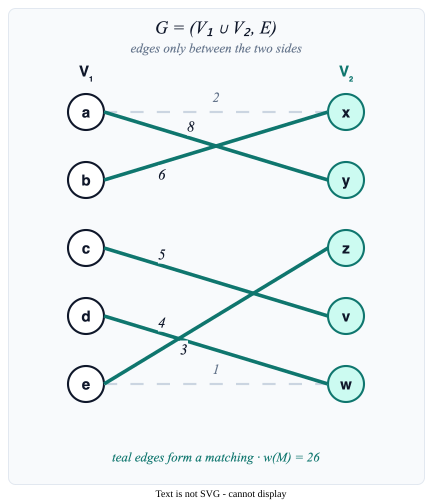
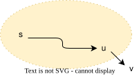
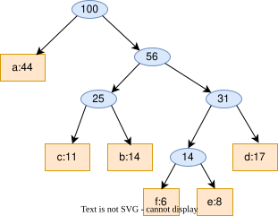

# Further Greedy Examples

Section 2.3 — Three more case studies — make change, Dijkstra, Huffman — where greedy sometimes wins and sometimes doesn't.

<div style="position: absolute; bottom: 20px; right: 30px; font-size: 0.55em; color: navy;">All references are to the 4th edition of <em>An Introduction to the Analysis of Algorithms</em> (World Scientific, 2025)</div>

---

# Overview

<div style="color: #9ca3af; font-style: italic; font-size: 0.9em; margin-bottom: 0.8em;">

Quick map of today's three case studies — and the headline answer to "does greedy work?" for each.

</div>

Three more examples of greedy algorithms:

1. **Make Change** - Sometimes greedy fails!
2. **Bipartite Matching** 
3. **Shortest Path (Dijkstra)** - Greedy works beautifully
4. **Huffman Codes** - Optimal data compression

---

# Make Change Problem

<div style="color: #9ca3af; font-style: italic; font-size: 0.9em; margin-bottom: 0.8em;">

Pay $n$ cents with the fewest coins — natural greedy is "always grab the biggest coin that fits."

</div>

**Problem:** Pay amount $n$ using the fewest coins

**Denominations:** $C = \lbrace 1, 10, 25, 100 \rbrace$ (cents)

**Greedy approach to Make Change:**

<span style="font-size: 0.6em; color: navy;">Alg 13, Pg 45, alg:makechange</span>

```text
C ← {1, 10, 25, 100}; L ← ∅; s ← 0
while s < n:
    find largest x in C such that s + x ≤ n
    L ← L ∪ {x}; s ← s + x
return L
```

Always pick the largest coin that doesn't exceed the remaining amount.

---

# Make Change: Does Greedy Work?

<div style="color: #9ca3af; font-style: italic; font-size: 0.9em; margin-bottom: 0.8em;">

A 6-coin disaster vs. a 3-coin optimum — greedy *can* fail, even on a familiar coin set.

</div>

**Example:** Coins $\{1,10,25\}$ (a proper subset of US denominations) and target is $30$ cents

Greedy: $25 + 1 + 1 + 1 + 1 + 1 = 30$ → **6 coins**

Optimal: $10 + 10 + 10 = 30$ → **3 coins**

**Greedy fails!** The algorithm is not optimal for this denomination.

---

# When Does Make Change Work?

<div style="color: #9ca3af; font-style: italic; font-size: 0.9em; margin-bottom: 0.8em;">

Powers of a single base $p$ — like binary or decimal — make greedy provably optimal.

</div>

**Theorem:** If $C = \lbrace 1, p, p^2, \ldots, p^k \rbrace$ for some $p > 1$, then greedy always finds the optimal solution.

Examples where greedy works:
- Binary: $\lbrace 1, 2, 4, 8, 16, \ldots \rbrace$
- Decimal: $\lbrace 1, 10, 100, 1000, \ldots \rbrace$

Examples where greedy may fail:
- A subset of US coins: $\lbrace 1, 10, 25 \rbrace$ (fails for 30 cents)
- Custom: $\lbrace 1, 3, 4 \rbrace$ (fails for 6: greedy gives $4+1+1$, optimal is $3+3$)

---

# Maximum Weight Matching

<div style="color: #9ca3af; font-style: italic; font-size: 0.9em; margin-bottom: 0.8em;">

Greedy by weight *can* fail here too — Edmonds' blossom algorithm is the real fix.

</div>

<div style="display: grid; grid-template-columns: 0.95fr 1.05fr; gap: 1.1rem; align-items: center; text-align: left;">

<div>

**Setup:** Bipartite graph $G = (V_1 \cup V_2, E)$ with edge weights

**Matching:** Set $M \subseteq E$ where no two edges share a vertex

**Natural greedy approach:**
1. Sort edges by weight (descending)
2. Add each edge if it doesn't share vertices with existing edges

**Does it work?** Not always! (Problem 2.29)

**Special case:** If all weights are distinct powers of 2, greedy works!

</div>



</div>

---

# Shortest Path Problem

<div style="color: #9ca3af; font-style: italic; font-size: 0.9em; margin-bottom: 0.8em;">

The problem behind every GPS, every router, every map app — find cheapest paths from a single source.

</div>

<div style="display: grid; grid-template-columns: 0.9fr 1.1fr; gap: 1.1rem; align-items: start; text-align: left;">

<div>

**Setup:**
- Graph $G = (V, E)$
- Start node $s$
- Cost function $c(e)$ for each edge

**Goal:** Find cheapest path from $s$ to every other node

(Cost of path = sum of edge costs)

</div>

<div style="font-size: 0.82em;">

**Breakthroughs**

| Year | Result |
|------|--------|
| 1959 | Dijkstra, $O(n^2)$; later $O(m + n\log n)$ with Fibonacci heaps |
| 1999 | Thorup: undirected integers, $O(m+n)$ in the RAM model |
| 2023 | Duan–Mao–Shu–Yin: first break of Dijkstra on undirected reals |
| 2025 | same group, directed: $O(m\log^{2/3}n)$ |
| 2026 | Kadria–Roditty: first improvement since FOCS 2023 |

</div>

</div>

---

# Dijkstra's Algorithm: The Idea

<div style="color: #9ca3af; font-style: italic; font-size: 0.9em; margin-bottom: 0.8em;">

Grow an "explored region" outward from $s$, recording the best known cost to each frontier node.

</div>

<div style="display: grid; grid-template-columns: 0.95fr 1.05fr; gap: 1.1rem; align-items: center; text-align: left;">

<div>

Like old cartographers mapping unknown territory!

- Maintain set $S$ of "explored" nodes
- For each $u \in S$, store $d(u)$ = cost of cheapest path from $s$ to $u$ within $S$
- Initially: $S = \lbrace s \rbrace$, $d(s) = 0$

**Expanding the frontier:**



</div>

<div style="display: grid; grid-template-columns: 1fr 1fr; gap: 0.7rem; align-items: start; justify-items: center;">

<figure style="margin: 0; text-align: center;">

<figcaption style="font-size: 0.55em; color: #64748b; margin-top: 0.35em; text-align: center;">Edsger W. Dijkstra</figcaption>
</figure>

<figure style="margin: 0; text-align: center;">

<figcaption style="font-size: 0.55em; color: #64748b; margin-top: 0.35em; text-align: center;">Amsterdam, 1956</figcaption>
</figure>

</div>

</div>

---

# Dijkstra's Algorithm: The Rule

<div style="color: #9ca3af; font-style: italic; font-size: 0.9em; margin-bottom: 0.8em;">

Each round: pick the unexplored node with the smallest tentative distance and lock it in.

</div>

For each unexplored $v \in V - S$, compute:

$$d'(v) = \min_{u \in S, e=(u,v)} [d(u) + c(e)]$$

- This is the shortest path to $v$ through explored territory
- Choose $v$ that minimizes $d'(v)$
- Add $v$ to $S$ and set $d(v) = d'(v)$
- Repeat until $S = V$

---

# Why Does Dijkstra's Algorithm Work?

<div style="color: #9ca3af; font-style: italic; font-size: 0.9em; margin-bottom: 0.8em;">

Any detour outside $S$ can only get longer — but this argument *requires* non-negative edge costs.

</div>

**Key insight:** When we add $v$ to $S$, we've found the shortest path to $v$.

**Why?** Any other path to $v$ must:
1. Leave $S$ at some point through some node $w$
2. But we chose $v$ because it had the smallest $d'$ value
3. So any path through $w$ is at least as long

**Important assumption:** All edge costs are non-negative!

(With negative edges, this argument fails)

---

# Dijkstra: Complexity

<div style="color: #9ca3af; font-style: italic; font-size: 0.9em; margin-bottom: 0.8em;">

$O(n^2)$ with arrays, $O((n+m) \log n)$ with a heap — fast enough that internet routing runs it on every router.

</div>

- At most $n$ iterations (add one node per iteration)
- Each iteration: examine all edges leaving $S$
- **Simple implementation:** $O(n^2)$
- **With priority queue:** $O((n + m) \log n)$

**Real-world application:** OSPF (Open Shortest Path First) routing protocol uses Dijkstra's algorithm!

---

# The Term Paper

<div style="color: #9ca3af; font-style: italic; font-size: 0.9em; margin-bottom: 0.8em;">

MIT, 1951. Robert Fano offers his class a deal: sit the final exam, or find the optimal binary code.

</div>

<div class="grid grid-cols-2 gap-6">
<div>

David Huffman, a graduate student, takes the paper.

What Fano does **not** mention: he and **Claude Shannon** have both already tried and failed. The problem is open.

Months of dead ends. Huffman is about to throw his notes away when he reverses the direction of attack.

</div>
<div>

| | Shannon–Fano | Huffman |
|---|---|---|
| Direction | top-down | **bottom-up** |
| First move | split the alphabet in half | **merge the two rarest** |
| Result | good | **provably optimal** |

</div>
</div>

The student's term paper beat the professor's algorithm. It is now in every ZIP file on Earth.

---

# Huffman Codes

<div style="color: #9ca3af; font-style: italic; font-size: 0.9em; margin-bottom: 0.8em;">

Frequent letters get short codes, rare letters get long ones — variable-length encoding done optimally.

</div>

**Problem:** Compress data using variable-length codes

- Fixed-length: Each character uses same number of bits
- Variable-length: Frequent characters get shorter codes

**Example:** String of 100 characters over $\lbrace a, b, c, d, e, f \rbrace$

| Char | a | b | c | d | e | f |
|------|---|---|---|---|---|---|
| Freq | 44 | 14 | 11 | 17 | 8 | 6 |

Fixed-length: 6 chars → 3 bits each → 300 bits total

---

# Prefix Codes

<div style="color: #9ca3af; font-style: italic; font-size: 0.9em; margin-bottom: 0.8em;">

No codeword is a prefix of another — that's exactly what makes a binary tree a valid decoder.

</div>

**Prefix code:** No codeword is a prefix of another codeword

**Why prefix codes?**
- Decoding is unambiguous
- No separator needed between codewords
- Any code can be converted to a prefix code (no loss)

**Representation:** Binary tree where:
- Leaves = characters (with frequencies)
- Internal nodes = sum of frequencies in subtree
- Code = path from root (0 = left, 1 = right)

---

# Huffman Tree Example

<div style="color: #9ca3af; font-style: italic; font-size: 0.9em; margin-bottom: 0.8em;">

The frequent letter $a$ gets a 1-bit code; rare $e$ and $f$ pay 4 bits each — fair trade.

</div>

<div class="grid grid-cols-2 gap-4">
<div>

| Char | Code | Bits |
|------|------|------|
| a | 0 | 1 |
| b | 101 | 3 |
| c | 100 | 3 |
| d | 111 | 3 |
| e | 1101 | 4 |
| f | 1100 | 4 |

</div>
<div class="flex items-center">



</div>
</div>

---

# Computing Total Bits

<div style="color: #9ca3af; font-style: italic; font-size: 0.9em; margin-bottom: 0.8em;">

226 bits vs. 300 — a 25% saving on this tiny example, and far more on real text.

</div>

With variable-length encoding:

$$44 \times 1 + 14 \times 3 + 11 \times 3 + 17 \times 3 + 8 \times 4 + 6 \times 4$$

$= 44 + 42 + 33 + 51 + 32 + 24 = 226$ bits

**Savings:** $300 - 226 = 74$ bits (25% reduction!)

---

# Huffman's Algorithm

<div style="color: #9ca3af; font-style: italic; font-size: 0.9em; margin-bottom: 0.8em;">

Repeatedly *merge the two least-frequent nodes* — the tree builds itself from the leaves up.

</div>

<span style="font-size: 0.6em; color: navy;">Alg 14, Pg 50, alg:huffman</span>

```text
n ← |Σ|; Q ← Σ (priority queue by frequency)
for i = 1 to n-1:
    allocate new node z
    left[z] ← x = extract-min(Q)
    right[z] ← y = extract-min(Q)
    f(z) ← f(x) + f(y)
    insert z into Q
return remaining node (root of tree)
```

**Greedy choice:** Always merge the two least frequent nodes!

---

# Huffman: Building the Tree

<div style="color: #9ca3af; font-style: italic; font-size: 0.9em; margin-bottom: 0.8em;">

Five merges, six leaves — the rarest letters end up *deepest*, exactly where we want them.

</div>

For $\lbrace a{:}44, b{:}14, c{:}11, d{:}17, e{:}8, f{:}6 \rbrace$:

1. Merge $f(6)$ and $e(8)$ → node with frequency 14
2. Merge $c(11)$ and $b(14)$ → node with frequency 25
3. Merge (fe:14) and $d(17)$ → node with frequency 31
4. Merge (cb:25) and (fed:31) → node with frequency 56
5. Merge $a(44)$ and (cbfed:56) → root with frequency 100

---

# Why Huffman is Optimal

<div style="color: #9ca3af; font-style: italic; font-size: 0.9em; margin-bottom: 0.8em;">

The two rarest characters *must* be siblings at max depth — anything else can be improved by swapping.

</div>

**Key insight:** In an optimal tree:
- The two lowest-frequency characters should be siblings
- They should be at the maximum depth

**Proof idea:**
- If lowest-frequency chars aren't at max depth, swap them with deeper nodes
- This can only decrease total bits
- Huffman builds the tree bottom-up, ensuring this property

---

# Huffman: Complexity

<div style="color: #9ca3af; font-style: italic; font-size: 0.9em; margin-bottom: 0.8em;">

A heap gives $O(n \log n)$ — and this little algorithm hides inside ZIP, JPEG, MP3, and PNG.

</div>

- $n-1$ iterations (merge operations)
- Each iteration: 2 extract-min + 1 insert
- With binary heap: $O(\log n)$ per operation
- **Total:** $O(n \log n)$

**Applications:**
- ZIP, GZIP compression
- JPEG, MP3 (combined with other techniques)
- Many communication protocols

---

# What Is One Bit Actually Worth?

<div style="color: #9ca3af; font-style: italic; font-size: 0.9em; margin-bottom: 0.8em;">

Entropy measures how much is *left to learn*. Turn it around and it measures how much you actually *know*.

</div>

<div class="grid grid-cols-2 gap-6">
<div>

Someone claims an edge: they can call a coin flip **51%** of the time.

Information gained per call:

$$1 - H(0.51) = 0.000289 \text{ bits}$$

| Claim | Bits per call |
|---|---|
| Fair coin (no edge) | 0 |
| 51% caller | 0.000289 |
| Perfect oracle | 1 |

</div>
<div>

**Consequences**

- One full bit of knowledge takes **~3,465 calls**
- 200,000 calls carry about **58 bits ≈ 7 bytes** of real signal
- Those same 200,000 calls are **25 KB** of raw data

A genuine edge is a few bytes hidden inside 25 KB of noise.

**It is not a pattern you can see.**

</div>
</div>

---

# Greedy Algorithms: Summary

<div style="color: #9ca3af; font-style: italic; font-size: 0.9em; margin-bottom: 0.8em;">

A scoreboard of every greedy algorithm in the chapter — three winners, two with caveats.

</div>

| Algorithm | Greedy Choice | Works? |
|-----------|---------------|--------|
| Make Change | Largest coin | Sometimes |
| Max Weight Matching | Heaviest edge | Sometimes |
| Shortest Path | Closest unexplored | Yes (non-negative) |
| Huffman | Merge least frequent | Yes |
| Kruskal (MCST) | Cheapest edge | Yes |
| Job Scheduling | Most profitable | Yes |

---

# When Does Greedy Work?

<div style="color: #9ca3af; font-style: italic; font-size: 0.9em; margin-bottom: 0.8em;">

Four signals — greedy choice, optimal substructure, exchange argument, *promising* invariant.

</div>

**Look for these properties:**

1. **Greedy choice property:** A locally optimal choice leads to a globally optimal solution

2. **Optimal substructure:** An optimal solution contains optimal solutions to subproblems

3. **Exchange argument:** Can always improve a non-greedy solution to match the greedy choice

4. **"Promising" invariant:** Partial solution can always be extended to optimal

---

# Key Problems

<div style="color: #9ca3af; font-style: italic; font-size: 0.9em; margin-bottom: 0.8em;">

Implement, break, and prove — the homework that turns these case studies into instinct.

</div>

1. **Problem 2.26:** Implement the make-change algorithm <span style="font-size: 0.6em; color: navy;">Prb 2.26, Pg 44, exr:makechange-program</span> <a href="https://github.com/michaelsoltys/IAA/blob/main/Problems/P2.26_Make-Change.py" style="font-size: 0.6em; color: teal;">[Python solution]</a>

2. **Problem 2.27:** Show greedy make-change can be suboptimal <span style="font-size: 0.6em; color: navy;">Prb 2.27, Pg 45, exr:suboptimal-change</span>

3. **Problem 2.28:** Prove greedy works when $C = \lbrace 1, p, p^2, \ldots, p^k \rbrace$ <span style="font-size: 0.6em; color: navy;">Prb 2.28, Pg 45, exr:makechange</span>

4. **Problem 2.29:** Find a bipartite graph where greedy matching fails <span style="font-size: 0.6em; color: navy;">Prb 2.29, Pg 45, exr:matching</span>

5. **Problem 2.35:** Implement Huffman compression <span style="font-size: 0.6em; color: navy;">Prb 2.35, Pg 51, exr:huffman</span> <a href="https://github.com/michaelsoltys/IAA/blob/main/Problems/P2.35_Huffman.py" style="font-size: 0.6em; color: teal;">[Python solution]</a>
