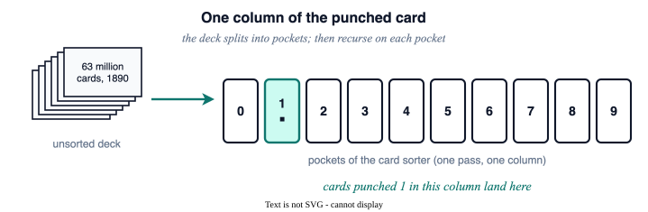
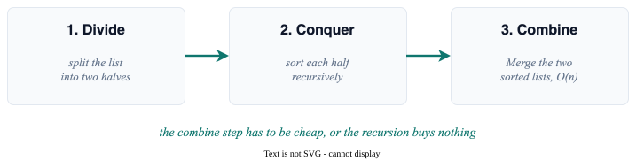
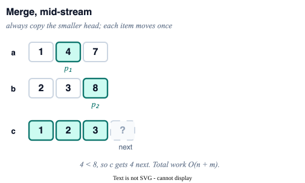
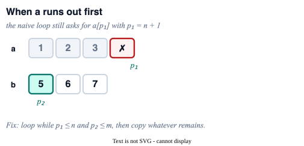
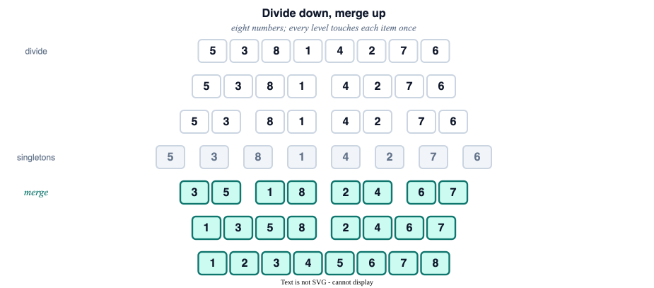
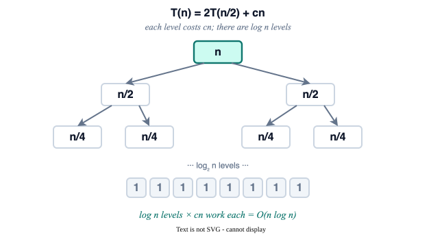

<style>
.slidev-layout.cover {
  background: white !important;
  color: black !important;
}
.slidev-layout.cover h1 {
  color: black !important;
}
</style>

# Mergesort

Section 3.1 — Divide a list, sort the halves, merge them: $O(n \log n)$, stable, and (for comparisons) optimal.

<div style="position: absolute; bottom: 20px; right: 30px; font-size: 0.55em; color: navy;">All references are to the 4th edition of <em>An Introduction to the Analysis of Algorithms</em> (World Scientific, 2025)</div>

---

# Herman Hollerith, 1860–1929

<div style="color: #9ca3af; font-style: italic; font-size: 0.9em; margin-bottom: 0.6em;">

The original industrial sorting problem was the United States census. The company it created is IBM.

</div>

<div style="display: grid; grid-template-columns: 0.85fr 1.15fr; gap: 1.2rem; align-items: center; text-align: left;">

<figure style="margin: 0; width: fit-content; text-align: left;">

<figcaption style="font-size: 0.55em; color: #64748b; margin-top: 0.35em; text-align: left;">Herman Hollerith</figcaption>
</figure>

<div style="font-size: 0.92em;">

- **1880:** census took **more than eight years** to tabulate by hand; the next one was due in 1890
- **1890:** punched-card machines finished the **count in six months**, the full tables in about two years, and saved the Census Office some **$5 million**
- **1896:** Tabulating Machine Company
- **1911:** folded into CTR
- **1924:** renamed **IBM**

</div>

</div>

---

# Sorting by splitting the deck

<div style="color: #9ca3af; font-style: italic; font-size: 0.9em; margin-bottom: 0.5em;">

Hollerith's card sorter is radix sort in oak and electromagnets: one column, ten pockets, then recurse.

</div>



---

# Divide et impera

<div style="color: #9ca3af; font-style: italic; font-size: 0.9em; margin-bottom: 0.5em;">

Take a large problem, split it, solve the pieces recursively, glue the answers. The glue has to be cheap.

</div>

<div style="display: grid; grid-template-columns: 1.15fr 0.85fr; gap: 1.1rem; align-items: center; text-align: left;">

<div>



The pattern pays off when an exhaustive method already exists and recursion improves the resource bound: time for mergesort and Karatsuba, space for Savitch.

</div>

<figure style="margin: 0; width: fit-content; text-align: left;">

<figcaption style="font-size: 0.55em; color: #64748b; margin-top: 0.35em; text-align: left; line-height: 1.3;">John von Neumann, 1945<br>mergesort as a demo of the stored-program computer</figcaption>
</figure>

</div>

---

# Sorting Algorithms

<div style="color: #9ca3af; font-style: italic; font-size: 0.9em; margin-bottom: 0.8em;">

A quick zoo of the classics: who is $O(n^2)$, who is $O(n \log n)$, and who is stable.

</div>

| Algorithm | Strategy | Time (avg) | Time (worst) | Stable? |
|-----------|----------|:----------:|:------------:|:-------:|
| **Insertion sort** | Insert each item in its proper position | $O(n^2)$ | $O(n^2)$ | Yes |
| **Selection sort** | Find minimum, swap to front, repeat | $O(n^2)$ | $O(n^2)$ | No |
| **Bubble sort** | Swap adjacent pairs, repeat until sorted | $O(n^2)$ | $O(n^2)$ | Yes |
| **Mergesort** | Divide in half, sort each, merge | $O(n \log n)$ | $O(n \log n)$ | Yes |
| **Quicksort** | Pick pivot, partition, recurse <span style="font-size: 0.6em; color: navy;">Prb 3.12, Pg 69, exr:quicksort</span> | $O(n \log n)$ | $O(n^2)$ | No |
| **Heapsort** | Like selection sort, but using a heap | $O(n \log n)$ | $O(n \log n)$ | No |

Mergesort and Quicksort are both **divide and conquer**. This chapter is Mergesort.

---

# The Merging Problem

<div style="color: #9ca3af; font-style: italic; font-size: 0.9em; margin-bottom: 0.5em;">

The subroutine that makes mergesort linear per level: fuse two sorted lists into one.

</div>

<div style="display: grid; grid-template-columns: 0.85fr 1.15fr; gap: 1.0rem; align-items: center; text-align: left;">

<div style="font-size: 0.92em;">

Two sorted lists:

$$a_1 \leq \cdots \leq a_n, \quad b_1 \leq \cdots \leq b_m$$

One sorted list:

$$c_1 \leq \cdots \leq c_{n+m}$$

Two pointers walk the heads. At every step copy the smaller head into $c$. Each element moves once: $O(n+m)$.

</div>



</div>

---

# Merge Algorithm

<div style="color: #9ca3af; font-style: italic; font-size: 0.9em; margin-bottom: 0.6em;">

Two pointers, one comparison per step, copy the smaller head.

</div>

Merge Two Lists:

<span style="font-size: 0.6em; color: navy;">Alg 16, Pg 62, alg:merge</span>

```text
  Pre-condition: a₁ ≤ a₂ ≤ ··· ≤ aₙ and b₁ ≤ b₂ ≤ ··· ≤ bₘ
  p₁ ← 1; p₂ ← 1; i ← 1
  while i ≤ n + m:
    if a[p₁] ≤ b[p₂]:
      c[i] ← a[p₁]
      p₁ ← p₁ + 1
    else:
      c[i] ← b[p₂]
      p₂ ← p₂ + 1
    i ← i + 1
  Post-condition: c₁ ≤ c₂ ≤ ··· ≤ c_{n+m}
```

**Complexity:** $O(n + m)$. Each element is compared at most once.

---

# A Subtle Bug

<div style="color: #9ca3af; font-style: italic; font-size: 0.9em; margin-bottom: 0.5em;">

The obvious loop reads past the end of whichever list finishes first.

</div>

<div style="display: grid; grid-template-columns: 0.9fr 1.1fr; gap: 1.0rem; align-items: center; text-align: left;">

<div style="font-size: 0.92em;">

The Merge algorithm as stated is **incorrect**.

If every $a_i$ is smaller than $b_1$, then after $n$ steps $p_1 = n+1$, and the next test $a_{p_1} \leq b_{p_2}$ is an **out-of-bounds** read.

**Fix:** loop while $p_1 \leq n$ **and** $p_2 \leq m$, then copy whatever remains. <span style="font-size: 0.6em; color: navy;">Prb 3.1, Pg 62, exr:merge-incorrect</span>

</div>



</div>

---

# The Mergesort Algorithm

<div style="color: #9ca3af; font-style: italic; font-size: 0.9em; margin-bottom: 0.6em;">

Split the list in half, recurse, merge. Three lines, and the list is sorted.

</div>

<span style="font-size: 0.6em; color: navy;">Alg 17, Pg 63, alg:mergesort</span> <a href="https://github.com/michaelsoltys/IAA/blob/main/Problems/P3.4_Mergesort.py" style="font-size: 0.6em; color: teal;">[Python solution]</a>

```text
Mergesort:
  Pre-condition: A list of integers a₁, a₂, ..., aₙ
  L ← a₁, a₂, ..., aₙ
  if |L| ≤ 1:
    return L
  else:
    L₁ ← first ⌈n/2⌉ elements of L
    L₂ ← last  ⌊n/2⌋ elements of L
    return Merge(Mergesort(L₁), Mergesort(L₂))
  Post-condition: a_{i₁} ≤ a_{i₂} ≤ ··· ≤ a_{iₙ}
```

**Divide** the list. **Conquer** each half. **Combine** with Merge.

---

# Example Walkthrough

<div style="color: #9ca3af; font-style: italic; font-size: 0.85em; margin-bottom: 0.4em;">

Eight numbers split to singletons, then reassemble. Every level touches each item once.

</div>



---

# Complexity Analysis

<div style="color: #9ca3af; font-style: italic; font-size: 0.9em; margin-bottom: 0.4em;">

$T(n) = 2T(n/2) + cn$ unfolds to $O(n \log n)$, and that is optimal for comparison sorts.

</div>

<div style="display: grid; grid-template-columns: 0.85fr 1.15fr; gap: 0.8rem; align-items: center; text-align: left;">

<div style="font-size: 0.88em;">

$$T(n) \leq T(\lceil n/2 \rceil) + T(\lfloor n/2 \rfloor) + cn$$

Floors and ceilings do not change the asymptotics:

$$T(n) \leq 2T(n/2) + cn$$

Master method, $a=2$, $b=2$, $f(n)=cn$: Case 2, so $T(n)=\Theta(n\log n)$.

A comparison sort is a binary decision tree on $n!$ permutations, hence $\Omega(n\log n)$ in the worst case. Mergesort matches the bound.

</div>



</div>

---

# After the $O(n \log n)$

<div style="color: #9ca3af; font-style: italic; font-size: 0.9em; margin-bottom: 0.6em;">

Stable, sequential, and still the sort that runs when the data will not fit in RAM.

</div>

<div style="text-align: left; font-size: 0.92em;">

- **Stable.** Equal keys keep their input order, which is why a merge, not a partition, sits under Python, Java, Swift, and Rust.
- **Sequential access.** 1950s magnetic tape could not rewind cheaply. Mergesort reads each run front to back, so it became **external sort**; database engines and MapReduce's shuffle still do this.
- **Linked lists.** No random access required. $O(n \log n)$ time, $O(1)$ extra cells if the merge splices pointers.
- **The stack is thin.** Recursion depth $O(\log n)$. The *array* extra is $O(n)$; that is the usual price against in-place quicksort.

</div>
