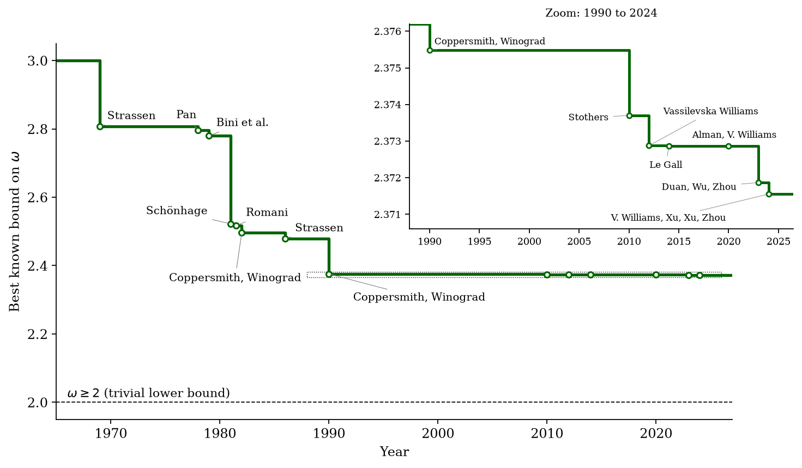

<style>
.slidev-layout.cover {
  background: white !important;
  color: black !important;
}
.slidev-layout.cover h1 {
  color: black !important;
}
</style>

# Multiplying Numbers in Binary

Section 3.2 — Karatsuba beats schoolbook $O(n^2)$ by trading one multiplication for some additions.

<div style="position: absolute; bottom: 20px; right: 30px; font-size: 0.55em; color: navy;">All references are to the 4th edition of <em>An Introduction to the Analysis of Algorithms</em> (World Scientific, 2025)</div>

---

# School Multiplication

<div style="color: #9ca3af; font-style: italic; font-size: 0.9em; margin-bottom: 0.4em;">

The grade-school algorithm in binary — same shifts and adds, $O(n^2)$ work for $n$-bit numbers.

</div>

Multiply $1110 \times 1101$ (i.e., $14 \times 13$):

<span style="font-size: 0.6em; color: navy;">Fig 3.1, Pg 64, fig:mult</span>

<div class="school-mult">

|       | 1 | 2 | 3 | 4 | 5 | 6 | 7 | 8 |
|-------|---|---|---|---|---|---|---|---|
| $x$   |   |   |   |   | 1 | 1 | 1 | 0 |
| $y$   |   |   |   |   | 1 | 1 | 0 | 1 |
| $s_1$ |   |   |   |   | 1 | 1 | 1 | 0 |
| $s_2$ |   |   |   | 0 | 0 | 0 | 0 |   |
| $s_3$ |   |   | 1 | 1 | 1 | 0 |   |   |
| $s_4$ |   | 1 | 1 | 1 | 0 |   |   |   |
| $x \times y$ | 1 | 0 | 1 | 1 | 0 | 1 | 1 | 0 |

</div>

**Complexity:** $O(n^2)$ for two $n$-bit integers

<style>
.school-mult {
  font-size: 0.9em;
  margin: 0.15em 0 0.25em;
}
.school-mult table {
  margin: 0.2em auto 0.15em;
}
.school-mult table :is(th, td) {
  padding-top: 0.1em !important;
  padding-bottom: 0.1em !important;
  line-height: 1.15 !important;
}
</style>

---

# Can We Do Better?

<div style="color: #9ca3af; font-style: italic; font-size: 0.9em; margin-bottom: 0.8em;">

Split each number into a high half and a low half — and the product expands into four pieces.

</div>

**Idea:** Break $n$-bit integers into $n/2$-bit halves

$$x = x_1 \cdot 2^{n/2} + x_0 \qquad y = y_1 \cdot 2^{n/2} + y_0$$


$x_1, y_1$ = high-order bits; $x_0, y_0$ = low-order bits


**Product expansion:**

$$xy = x_1 y_1 \cdot 2^n + (x_1 y_0 + x_0 y_1) \cdot 2^{n/2} + x_0 y_0$$


---

# First Attempt: 4 Recursive Multiplications

<div style="color: #9ca3af; font-style: italic; font-size: 0.9em; margin-bottom: 0.8em;">

Naive divide-and-conquer gives $T(n) = 4T(n/2) + cn$ — and that solves to the *same* $O(n^2)$.

</div>

To compute $xy$ we need four products: $x_1 y_1$, $x_1 y_0$, $x_0 y_1$, $x_0 y_0$


**Recurrence:**

$$T(n) \leq 4T(n/2) + cn$$


**Solution:** $T(n) = O(n^{\log_2 4}) = O(n^2)$

No improvement over school multiplication!

---

# Karatsuba's Trick: 3 Multiplications Suffice

<div style="color: #9ca3af; font-style: italic; font-size: 0.9em; margin-bottom: 0.8em;">

One product computes the cross term *for free* — drop from 4 recursive calls to 3.

</div>

**Key observation:**

$$x_1 y_0 + x_0 y_1 = (x_1 + x_0)(y_1 + y_0) - (x_1 y_1 + x_0 y_0)$$


So we only need **three** multiplications:
1. $x_1 y_1$
2. $x_0 y_0$
3. $(x_1 + x_0)(y_1 + y_0)$


The cross term $x_1 y_0 + x_0 y_1$ is recovered by subtraction (cheap!)

---

# Cost Comparison

<div style="color: #9ca3af; font-style: italic; font-size: 0.9em; margin-bottom: 0.8em;">

Trading a recursive multiplication for a cheap addition is always a win — the recurrence becomes $3T(n/2)$.

</div>

<span style="font-size: 0.6em; color: navy;">Fig 3.2, Pg 65, fig:recmult</span>

|                    | Multiplications | Additions | Shifts |
|--------------------|:-:|:-:|:-:|
| Method 1 (4 mults) | 4 | 3 | 2 |
| Method 2 (Karatsuba) | 3 | 4 | 2 |


Trading one multiplication for one addition is worth it — multiplications are **recursive** (expensive), while additions are $O(n)$ (cheap).


**New recurrence:**

$$T(n) \leq 3T(n/2) + dn$$

**Solution:** $T(n) = O(n^{\log_2 3}) \approx O(n^{1.59})$

---

# The Karatsuba Algorithm

<div style="color: #9ca3af; font-style: italic; font-size: 0.9em; margin-bottom: 0.8em;">

Three recursive multiplications, a few shifts and adds — and you've beaten schoolbook for big enough $n$.

</div>

<span style="font-size: 0.6em; color: navy;">Alg 18, Pg 66, alg:recmult</span> <a href="https://github.com/michaelsoltys/IAA/blob/main/Problems/P3.6_Binary-Mult.py" style="font-size: 0.6em; color: teal;">[Python solution]</a>

```text
Karatsuba(x, y):
  Pre-condition: Two n-bit integers x and y
  if n = 1:
    if x = 1 ∧ y = 1: return 1
    else: return 0
  (x₁, x₀) ← (first ⌊n/2⌋ bits, last ⌈n/2⌉ bits) of x
  (y₁, y₀) ← (first ⌊n/2⌋ bits, last ⌈n/2⌉ bits) of y
  z₁ ← Karatsuba(x₁, y₁)
  z₂ ← Karatsuba(x₁ + x₀, y₁ + y₀)
  z₃ ← Karatsuba(x₀, y₀)
  return z₁ · 2^{2⌈n/2⌉} + (z₂ - z₁ - z₃) · 2^{⌈n/2⌉} + z₃
  Post-condition: the product xy
```


**Note:** Multiplying by $2^k$ is just a left-shift — $O(1)$ cost, ignored in analysis

---

# Why Does It Work?

<div style="color: #9ca3af; font-style: italic; font-size: 0.9em; margin-bottom: 0.8em;">

Verify the algebra: $z_2 - z_1 - z_3$ recovers exactly the cross term we needed.

</div>

Starting from $xy = x_1 y_1 \cdot 2^n + (x_1 y_0 + x_0 y_1) \cdot 2^{n/2} + x_0 y_0$:


- $z_1 = x_1 y_1$ — high-order product
- $z_3 = x_0 y_0$ — low-order product
- $z_2 = (x_1 + x_0)(y_1 + y_0) = x_1 y_1 + x_1 y_0 + x_0 y_1 + x_0 y_0$
- $z_2 - z_1 - z_3 = x_1 y_0 + x_0 y_1$ — the cross term!

<span style="font-size: 0.6em; color: navy;">Prb 3.5, Pg 65, exr:recmult-correctness</span>

---

# The Same Trick for Matrices: Strassen's Algorithm

<div style="color: #9ca3af; font-style: italic; font-size: 0.9em; margin-bottom: 0.6em;">

Block matrices, naive recursion gives $O(n^3)$ — exactly Karatsuba's "no improvement" trap.

</div>

<div style="display: grid; grid-template-columns: 0.95fr 1.05fr; gap: 0.8rem 1.0rem; align-items: start; text-align: left;">

<div style="font-size: 0.88em;">

Standard matrix multiplication of two $n \times n$ matrices: $O(n^3)$

**Block decomposition:** split $A$ and $B$ into four $n/2 \times n/2$ submatrices.

**Naive block multiply** needs **8** recursive multiplications:

$$C_{11} = A_{11}B_{11} + A_{12}B_{21}$$
$$C_{12} = A_{11}B_{12} + A_{12}B_{22}$$
$$C_{21} = A_{21}B_{11} + A_{22}B_{21}$$
$$C_{22} = A_{21}B_{12} + A_{22}B_{22}$$

$$T(n) = 8T(n/2) + O(n^2) \implies O(n^{\log_2 8}) = O(n^3)$$

</div>

<figure style="margin: 0; width: 100%; text-align: left;">

</figure>

<div style="grid-column: 1 / -1; font-size: 0.95em;">

No improvement — same story as Karatsuba with 4 multiplications!

</div>

</div>

---

# Strassen's 7 Multiplications

<div style="color: #9ca3af; font-style: italic; font-size: 0.9em; margin-bottom: 0.8em;">

Seven cleverly-chosen products in place of eight — exponent drops from $3$ to $\log_2 7 \approx 2.81$.

</div>

<div class="flex gap-6 text-sm">
<div class="flex-1">

**Strassen (1969):** Compute 7 products instead of 8:

$$M_1 = (A_{11}+A_{22})(B_{11}+B_{22})$$
$$M_2 = (A_{21}+A_{22})B_{11}$$
$$M_3 = A_{11}(B_{12}-B_{22})$$
$$M_4 = A_{22}(B_{21}-B_{11})$$
$$M_5 = (A_{11}+A_{12})B_{22}$$
$$M_6 = (A_{21}-A_{11})(B_{11}+B_{12})$$
$$M_7 = (A_{12}-A_{22})(B_{21}+B_{22})$$

</div>
<div class="flex-1">

**Reconstruct $C$:**

$$C_{11} = M_1 + M_4 - M_5 + M_7$$
$$C_{12} = M_3 + M_5$$
$$C_{21} = M_2 + M_4$$
$$C_{22} = M_1 - M_2 + M_3 + M_6$$

**Running time:**

$$T(n) = 7T(n/2) + O(n^2) \implies O(n^{\log_2 7}) \approx O(n^{2.81})$$

</div>
</div>

---

# Strassen vs Karatsuba: The Same Idea

<div style="color: #9ca3af; font-style: italic; font-size: 0.9em; margin-bottom: 0.8em;">

Two famous algorithms, one structural insight — shave one recursive call, pay for it in additions.

</div>

<div class="text-sm">

| | Karatsuba (integers) | Strassen (matrices) |
|---|---|---|
| **Naive recursive calls** | 4 | 8 |
| **Optimized calls** | 3 | 7 |
| **Cheap operations** | $O(n)$ additions | $O(n^2)$ additions |
| **Naive complexity** | $O(n^2)$ | $O(n^3)$ |
| **Improved complexity** | $O(n^{1.59})$ | $O(n^{2.81})$ |
| **Practical crossover** | ~500 bits | ~64 rows |

</div>

<div class="mt-2">

**The pattern:** Trading one recursive multiplication for extra additions — because multiplications are recursive (expensive) but additions are only one level deep (cheap)

</div>

---

# Why Matrix Multiplication Matters

<div style="color: #9ca3af; font-style: italic; font-size: 0.9em; margin-bottom: 0.8em;">

Matrix multiplication is the inner loop of modern computing, so small savings add up fast.

</div>

<div class="grid grid-cols-2 gap-6 items-center">
<div class="text-sm">

- **Deep learning:** transformer attention and MLP layers are matrix multiplies (GEMM), the vast majority of training and inference FLOPs
- **Hardware:** GPU tensor cores and the TPU systolic array multiply-accumulate matrix tiles
- **Constants matter:** illustratively, 10% off a 100 million dollar training run saves about 10 million dollars
- **AlphaTensor** (DeepMind, *Nature*, 2022): 47 multiplications for 4×4 over GF(2), versus 49 for recursive Strassen
- **Graphs:** $\mathrm{tr}(A^3)/6$ counts triangles; PageRank is repeated matrix-vector products
- **Galactic:** the record $\omega$ bounds carry constants too large for practice

</div>
<figure style="margin: 0; width: 100%; text-align: left;">

<figcaption style="font-size: 0.55em; color: #64748b; margin-top: 0.35em; text-align: left;">Data after Quanta Magazine (2024)</figcaption>
</figure>
</div>

See Chapter 7, *Parallel Algorithms in Linear Algebra*, for more matrix algorithms: Gaussian elimination, Gram-Schmidt, Csanky, Berkowitz.

---

# The Exponent Is Still Moving

<div style="color: #9ca3af; font-style: italic; font-size: 0.9em; margin-bottom: 0.5em;">

Strassen's 2.81 was 1969. The best proven bound is still being improved.

</div>

<div style="font-size: 0.82em;">

The exponent $\omega$ is the infimum of $c$ such that $n \times n$ matrices multiply in $O(n^{c+o(1)})$.

| Year | Bound | Algorithm | Practical size |
|---|---|---|---|
| 1969 | $\omega < 2.81$ | Strassen: 7 recursive multiplies | $\sim 64\times 64$ |
| 1990 | $\omega < 2.376$ | Coppersmith, Winograd | galactic |
| 2025 | $\omega < 2.371339$ | Alman, Duan, Williams, Xu, Xu, Zhou | galactic |
| Aug 2026 | $\omega < 2.371177$ | Dupont et al., AlphaEvolve [arXiv](https://arxiv.org/abs/2608.16884) | galactic |
| Oct 2026 | $\omega < 2.37115924$ | Zadeh: CW-style search, 212,820 coordinates [arXiv](https://arxiv.org/html/2610.10593) | galactic |

None of this invents a new 7-product identity. The 2026 papers tune the same laser-method / Coppersmith–Winograd optimization more carefully (gradient descent, AlphaEvolve on the optimizer, then a certified numerical search with an offline verifier). The digits moved a little. The program you just saw is still live research, 57 years later. Whether $\omega = 2$ is open.

</div>
