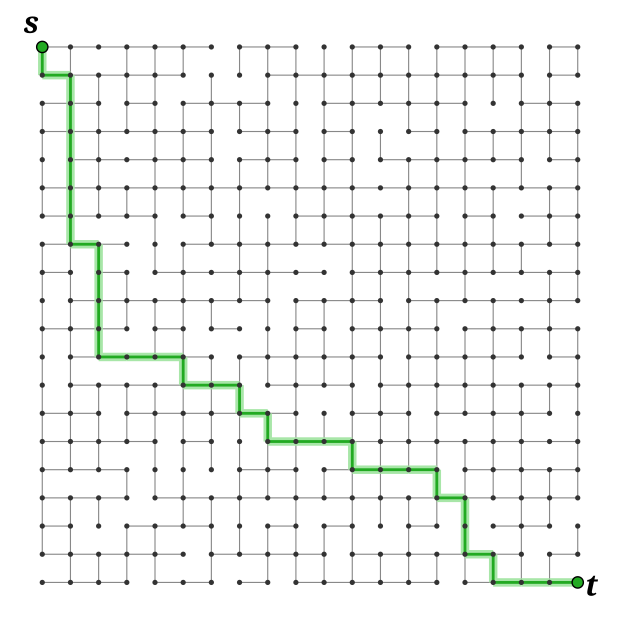
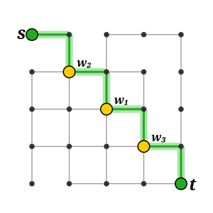

<style>
.slidev-layout.cover {
  background: white !important;
  color: black !important;
}
.slidev-layout.cover h1 {
  color: black !important;
}
</style>

# Savitch's Algorithm

Section 3.3 — Reachability in $O(\log^2 n)$ space, by guessing the midpoint of the path.

<div style="position: absolute; bottom: 20px; right: 30px; font-size: 0.55em; color: navy;">All references are to the 4th edition of <em>An Introduction to the Analysis of Algorithms</em> (World Scientific, 2025)</div>

---

# The Problem: Graph Reachability

<div style="color: #9ca3af; font-style: italic; font-size: 0.9em; margin-bottom: 0.8em;">

Is $t$ reachable from $s$? Forget shortest paths — we just want a yes/no, using as little memory as possible.

</div>

<div style="display: grid; grid-template-columns: 1fr 1fr; gap: 2rem; align-items: center;">
<div>

Given a directed graph $G$ and two nodes $s$ and $t$:

**Question:** Is there a path from $s$ to $t$?


We're not looking for the *shortest* path — just whether $t$ is **reachable** from $s$.


**Twist:** We want to minimize **space** (memory), not time!


</div>
<div style="text-align: center;">

</div>
</div>

---

# Why Care About Space?

<div style="color: #9ca3af; font-style: italic; font-size: 0.9em; margin-bottom: 0.8em;">

When the graph is the *Web*, you can't load the adjacency list — you can only afford a few hundred bits of state.

</div>

The graph may be given **implicitly**, not explicitly.


**Example:** The World Wide Web
- $V$ = all web pages
- $(x, y) \in E$ if page $x$ has a hyperlink to page $y$
- The graph is **enormous** — we can't store it all in memory
- We query pages piecemeal

Savitch's algorithm solves reachability in space $O(\log^2 n)$ — remarkably small!

---

# The Key Idea

<div style="color: #9ca3af; font-style: italic; font-size: 0.9em; margin-bottom: 0.8em;">

A path of length $\leq 2^i$ has a midpoint $w$ — guess it, and recurse on two halves of length $\leq 2^{i-1}$.

</div>

Define $\text{R}(G, u, v, i)$ = true iff there is a path from $u$ to $v$ of length $\leq 2^i$


**Recursive insight:** If a path exists from $u$ to $v$, it must have a **midpoint** $w$:

$$\text{R}(G, u, v, i) \iff (\exists w)[\text{R}(G, u, w, i-1) \wedge \text{R}(G, w, v, i-1)]$$


A path of length $\leq 2^i$ can be split into two paths of length $\leq 2^{i-1}$

---

# Savitch's Algorithm

<div style="color: #9ca3af; font-style: italic; font-size: 0.9em; margin-bottom: 0.8em;">

Try every vertex as midpoint, recurse on both halves — the recursion is the whole algorithm.

</div>

<span style="font-size: 0.6em; color: navy;">Alg 19, Pg 68, alg:savitch</span>

```text
R(G, u, v, i):
  if i = 0:
    if u = v: return true
    elif (u, v) is an edge: return true
  else:
    for every vertex w:
      if R(G, u, w, i-1) and R(G, w, v, i-1):
        return true
  return false
```


**To solve reachability:** Call $\text{R}(G, s, t, \lceil \log_2 n \rceil)$

since any path in an $n$-node graph has length $\leq n \leq 2^{\lceil \log_2 n \rceil}$


---

# Example: Recursion Stack

<div style="color: #9ca3af; font-style: italic; font-size: 0.9em; margin-bottom: 0.8em;">

The recursion tree only ever holds $O(\log n)$ midpoints at once — that's where the space savings come from.

</div>

<div style="display: grid; grid-template-columns: 1.1fr 1fr; gap: 1.5rem; align-items: center;">
<div>

5×5 grid; query $\text{R}(s, t, 3)$ — path of length $\leq 8$?


**Level 3:** guess midpoint $w_1$
$$\text{R}(s, w_1, 2) \;\wedge\; \text{R}(w_1, t, 2)$$

**Level 2 (left half):** guess $w_2$
$$\text{R}(s, w_2, 1) \;\wedge\; \text{R}(w_2, w_1, 1)$$

**Level 2 (right half):** guess $w_3$
$$\text{R}(w_1, w_3, 1) \;\wedge\; \text{R}(w_3, t, 1)$$

**Level 1 → 0:** each call splits once more, bottoming out at single edges ✓


Stack depth $= O(\log n)$; each frame stores one vertex.


</div>
<div style="text-align: center;">

</div>
</div>

---

# Space Analysis

<div style="color: #9ca3af; font-style: italic; font-size: 0.9em; margin-bottom: 0.8em;">

$\log n$ levels of recursion, $\log n$ bits per midpoint — multiply and you get $O(\log^2 n)$.

</div>

**Why $O(\log^2 n)$ space?**


- The recursion depth is at most $i \leq \lceil \log_2 n \rceil$
- At each level, we store one vertex $w$ — takes $s = O(\log n)$ bits
- **Total space:** $i \cdot s = O(\log n) \cdot O(\log n) = O(\log^2 n)$


**The trick:** The two recursive calls $\text{R}(G, u, w, i-1)$ and $\text{R}(G, w, v, i-1)$ are made **sequentially**, not in parallel — so the same stack space is reused!


---

# Time Complexity

<div style="color: #9ca3af; font-style: italic; font-size: 0.9em; margin-bottom: 0.8em;">

Tiny memory comes at a brutal price — running time blows up to $n^{O(\log n)}$.

</div>


What's the **time** cost of this space savings?


At each level $i$, we try all $n$ possible midpoints $w$, and each leads to two recursive calls at level $i - 1$:

$$T(n, i) \leq n \cdot 2 \cdot T(n, i-1)$$


This gives exponential time — $O(n^{2 \log n})$ — a huge cost for tiny space!

**Savitch's algorithm trades time for space.**

---

# Bonus: Quicksort & Git Bisect

<div style="color: #9ca3af; font-style: italic; font-size: 0.9em; margin-bottom: 0.8em;">

Two more divide-and-conquer favorites — one a sorting algorithm, the other a debugging tool.

</div>

Two more divide and conquer ideas from Section 3.4:


**Quicksort** — pick a pivot, partition, recurse:
```haskell
qsort [] = []
qsort (x:xs) = qsort smaller ++ [x] ++ qsort larger
  where
    smaller = [a | a <- xs, a <= x]
    larger  = [b | b <- xs, b > x]
```

**Git bisect** — binary search through commit history to find which commit introduced a bug. A practical application of divide and conquer!

---

# Chapter 3 Complete

<div style="color: #9ca3af; font-style: italic; font-size: 0.9em; margin-bottom: 0.8em;">

Three algorithms, one paradigm — sort faster, multiply faster, or solve reachability in microscopic space.

</div>

Divide and Conquer key takeaways:
- **Mergesort:** $O(n \log n)$ sorting via split-merge
- **Karatsuba:** $O(n^{1.59})$ multiplication via reducing recursive calls
- **Savitch:** $O(\log^2 n)$ space via midpoint recursion
