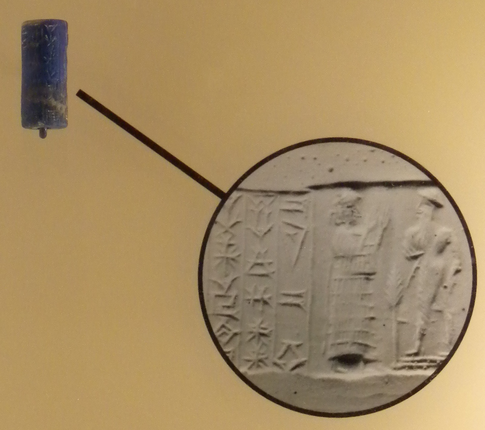
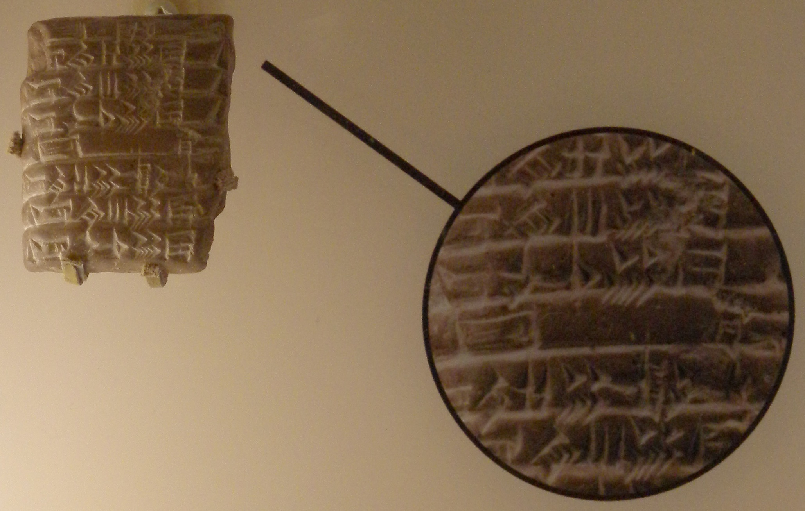

# Alphabets, Strings and Languages

Sections 9.1-9.2 — The vocabulary for the rest of the course: what a computation is *about* before we ask what can compute it.

All references are to the 4th edition of <em>An Introduction to the Analysis of Algorithms</em> (World Scientific, 2025)

---

# Where This Chapter Is Going

Programs instantiate algorithms. Hardware instantiates a *model of computation*.

The first serious attempt at a computer was Charles Babbage's **Difference Engine**, begun in the 1820s: decimal, and powered by cranking a handle. He never finished one — machining parts to the required precision was beyond the era.

**The chapter's arc:**

$$\text{finite automata} \;\longrightarrow\; \text{pushdown automata} \;\longrightarrow\; \text{Turing machines}$$

Each is a machine model, and each answers a different version of the same question: **what can be computed, and with what resources?**

Before any of that we need to say precisely what a machine is computing *about*. That is this lecture.

---

# Marks Before Machines

Storing information in discrete symbols is older than writing, and far older than arithmetic.

<strong>Engraved ocher</strong> Blombos Cave, South Africa 77,000–75,000 yrs

<strong>Ishango bone</strong> Congo, baboon leg, 3 rows of tallies 25,000–20,000 yrs

<strong>Reindeer antler</strong> La Madeleine, France 17,000–11,500 yrs

These are *marks*, not writing. A tally records quantity. It does not yet compose.

---

# From Marks to Writing

About 8,000 years ago the marks started standing for words. Then for sounds.

<strong>Cylinder seal</strong> rolled across wet clay. Lapis lazuli, Babylon, 4,100–3,600 yrs. Hard to carve, hard to forge: a signature.

<strong>Cuneiform tablet</strong>, near Babylon, 4,000–2,600 yrs. Marks stood first for concepts, later for <em>sounds and syllables</em>.

**That shift is the one that matters here.** Once a mark denotes a sound rather than a thing, you have a finite alphabet that can express unboundedly many messages. Everything in this chapter rests on it.

---

# Alphabet, String, Length

Three definitions, and everything else in the chapter is built from them.

Sec 9.2, Pg 218, sec:alphs-strings

An **alphabet** $\Sigma$ is a **finite, non-empty** set of distinct symbols.

$$\Sigma = \{0,1\} \quad\text{(binary)} \qquad \Sigma = \{a,b,c,\ldots,z\}$$

We write $\Sigma_\ell$ for a generic alphabet of size $\ell$, so $\Sigma_2 = \{0,1\}$.

A **string** (or **word**) is a *finite ordered* sequence of symbols from $\Sigma$.

$$w = 010011101011 \qquad |w| = 12$$

$|w|$ denotes the **length**. The **empty string** $\varepsilon$ is the unique string with $|\varepsilon| = 0$, and it belongs to every alphabet's strings by default.

**Read the fine print:** the alphabet is *finite*, and every string is *finite*. Both restrictions are load-bearing — drop either and the machines in this chapter stop making sense.

---

# Building Sets of Strings

$\Sigma^k$, then $\Sigma^*$: from strings of one length to all strings at once.

$\Sigma^k$ is the set of strings of length **exactly** $k$. For $\Sigma = \{0,1\}$:

$$\Sigma^0 = \{\varepsilon\}$$
$$\Sigma^1 = \Sigma$$
$$\Sigma^2 = \{00, 01, 10, 11\}$$

**How big is $\Sigma^k$?** $\;|\Sigma|^k$.

Note $\Sigma^0 = \{\varepsilon\}$, not $\emptyset$ — there is exactly one string of length zero.

**Kleene's star** $\Sigma^*$ is the set of *all* strings over $\Sigma$:

$$\Sigma^* = \Sigma^0 \cup \underbrace{\Sigma^1 \cup \Sigma^2 \cup \Sigma^3 \cup \cdots}_{\textstyle =\;\Sigma^+}$$

$\Sigma^+$ is the same thing without $\varepsilon$.

**Concatenation** is juxtaposition. For $x = a_1\ldots a_m$ and $y = b_1\ldots b_n$:

$$x \cdot y = xy = a_1\ldots a_m b_1 \ldots b_n$$

and $w\varepsilon = \varepsilon w = w$.

**$\Sigma^*$ is infinite, but every string in it is finite.** No string has infinite length.

---

# Languages

A language is just a set of strings. That simplicity is the point.

A **language** $L$ over $\Sigma$ is any collection of strings: $\;L \subseteq \Sigma^*$.

$$L = \{\varepsilon, 01, 0011, 000111, \ldots\} = \{0^n 1^n \mid n \ge 0\}$$

Eq 9.1, Pg 218, eq:example

| | |
|---|---|
| $\{\varepsilon\}$ | the language containing exactly one string, the empty one |
| $\emptyset$ | the empty language, containing **no** strings |

$|\{\varepsilon\}| = 1$ and $|\emptyset| = 0$. They are as different as a bag holding one blank sheet and a bag holding nothing.

**Why "language"?** Because a decision problem *is* a language: the set of inputs whose answer is yes. Asking "is this number prime?" is asking "is this string in $L_{\text{prime}}$?"

---

# The Two Questions

Everything from here to the end of the course is one of these.

**1. How do we *describe* a language?**

The set-builder notation above is informal prose. We need finite, mechanical descriptions — that is what regular expressions and grammars are for.

**2. Given $L \subseteq \Sigma^*$ and a string $x$, how do we *check* whether $x \in L$?**

$$L = \{\underbrace{10}_{2}, \underbrace{11}_{3}, \underbrace{101}_{5}, \underbrace{111}_{7}, \ldots\} \subseteq \{0,1\}^*$$

that is, $w \in L$ exactly when $w$ is the binary encoding of a prime.

A finite description of an infinite set, and a procedure to test membership. **And that raises the question the rest of the chapter exists to answer: what *is* an algorithm?**

---

# Summary

Small vocabulary, large consequences.

| | |
|---|---|
| **Alphabet** $\Sigma$ | finite, non-empty |
| **String** $w$ | finite sequence; $\lvert w\rvert$ its length |
| $\varepsilon$ | the unique string of length 0 |
| $\Sigma^k$ | length exactly $k$; size $\lvert\Sigma\rvert^k$ |
| $\Sigma^*,\ \Sigma^+$ | all strings; all non-empty |
| **Language** $L$ | any subset of $\Sigma^*$ |

**Carry forward**

1. A **decision problem is a language.**
2. **Finite descriptions of infinite sets** — regular expressions, grammars, machines.
3. $\{\varepsilon\} \neq \emptyset$, and $\Sigma^*$ is infinite while every member is finite.

**Problem 9.1:** $|\Sigma_2^k|$? $|\Sigma_\ell^k|$? If $L$ is the strings over $\Sigma_\ell$ with no repeated symbol, what is $|L|$?

Prb 9.1, Pg 218, exr:word-count

