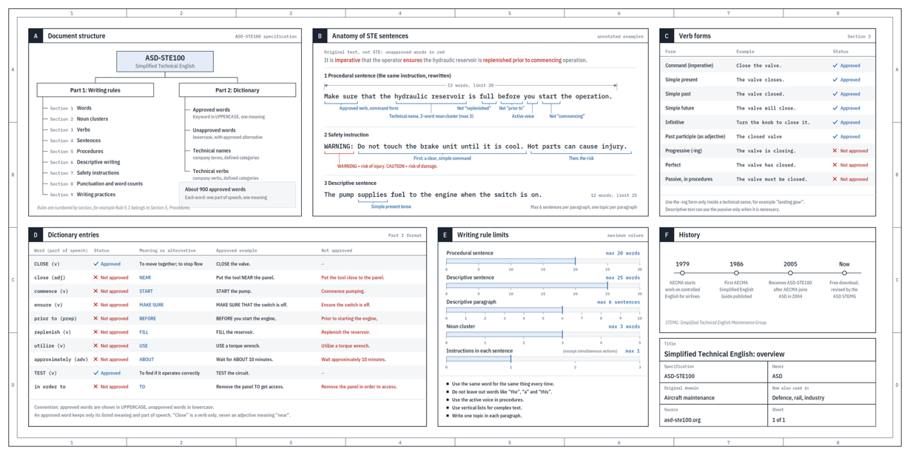

# Context-Free Grammars

Section 9.4.1 — The grammars that describe nested structure: programming languages, balanced parentheses, and arithmetic expressions.

All references are to the 4th edition of <em>An Introduction to the Analysis of Algorithms</em> (World Scientific, 2025)

---

# Overview

A roadmap of the eight ideas we'll need to define, parse, and reason about context-free languages.

Context-free grammars formalize the syntax of programming languages

**Key concepts:**
1. **CFG definition** — the 4-tuple $G = (V, T, P, S)$
2. **Derivations** — how strings are generated
3. **Parse trees** — structural representation of derivations
4. **Ambiguity** — when a string has two different parse trees
5. **Chomsky Normal Form** — a canonical form for CFGs
6. **CYK algorithm** — membership testing for CFLs
7. **Pumping Lemma** — proving languages are not context-free
8. **Closure properties** — what operations preserve CFLs

---

# Aviation Solved Ambiguity in 1986

Karpathy's tip meets a 40-year controlled language: the hook for why formal constraints matter.

**Andrej Karpathy** (Oct 2026): ask the LLM to write in **ASD-STE100** (or "80% of the way"). Models already know this aerospace controlled language.

**Aakash Gupta:** late-1970s airlines handed English manuals to mechanics worldwide. One ambiguous fuel-line sentence can get people killed. Aviation banned ambiguity at the dictionary level.

- Training data rewards fluency: hedging, synonym-cycling
- STE: decades of rules for stripping exactly that out
- Gupta: maybe the strongest anti-slop prompt, and the PDF is free

COMP 454: the prompt hack is the door. The lasting point is **restricted formal languages**.

<a href="https://x.com/aakashgupta/status/2105884986138411482" target="_blank" rel="noopener">x.com/aakashgupta/status/2105884986138411482</a> (quoting Karpathy on ASD-STE100)

---

# STE Rules ↔ Context-Free Grammars

ASD-STE100 is a controlled language. CFGs encode the same idea for programs.

**STE (lexicon + form)**

- ~**900 approved words**
- Each word: **one meaning**, **one part of speech**
- "Close" is only a verb
- "Follow" = come after; for obey, write **obey**
- Max **20 words**/instruction, **active voice**
- ~**1,200 words banned** with mandated replacements

**CFG connection**

- A CFG fixes which strings are legal and how they nest
- **Ambiguity** = two parse trees = two meanings
- STE forbids dictionary collisions that invite dual readings
- Same impulse: ban ambiguity where meaning is load-bearing
- English ~170k words; aviation gave mechanics **900**

**Why here:** natural language is ambiguous by default. Formal subsets (STE, programming-language grammars) are a design choice.

---

# ASD-STE100 at a Glance

Vocabulary, grammar rules, and the write/check cycle in one picture.

- Limited vocabulary (~875 approved words in the overview graphic)
- Grammar and style rules for clear procedures
- Write → check cycle before release

Spec: free ASD-STE100 PDF.

---
layout: section
---

# CFG Definition

Generative grammars for programming languages — productions that rewrite variables into strings.

---

# Context-Free Grammar

The four pieces — variables, terminals, productions, and a start symbol — that together generate a language.

A **context-free grammar (CFG)** is $G = (V, T, P, S)$

- **$V$** — Finite set of **variables** (nonterminals)
- **$T$** — Finite set of **terminals**
- **$P$** — Finite set of **productions** (rules)
- **$S \in V$** — **Start variable**

Each production has the form $A \longrightarrow \alpha$ where $A \in V$ and $\alpha \in (V \cup T)^*$

---

# Example: Palindromes

A tiny five-rule grammar that captures exactly the strings reading the same forwards and backwards.

$$P \longrightarrow \varepsilon \mid 0 \mid 1 \mid 0P0 \mid 1P1$$

**Lemma:** This grammar generates exactly the set of palindromes over $\{0, 1\}$

**Proof ($\Rightarrow$):** If $w$ is a palindrome, show $P \stackrel{*}{\Rightarrow} w$ by induction on $|w|$

- **BS:** $|w| \leq 1$, so $w = \varepsilon, 0, 1$ — use $P \longrightarrow \varepsilon, 0, 1$
- **IS:** For $|w| \geq 2$, $w = 0x0$ or $w = 1x1$, and by IH $P \stackrel{*}{\Rightarrow} x$

**Proof ($\Leftarrow$):** If $P \stackrel{*}{\Rightarrow} w$, show $w = w^R$ by induction on derivation steps

- **BS:** Derivation has 1 step
- **IS:** $P \Rightarrow 0P0 \stackrel{*}{\Rightarrow} 0x0 = w$ (or with 1 instead of 0)

---

# Example: Algebraic Expressions

A three-variable grammar that builds operator precedence ($\times$ binds tighter than $+$) into the parse tree.

$G = (\{E, T, F\}, \Sigma, P, E)$ where $\Sigma = \{a, +, \times, (, )\}$

$$E \longrightarrow E + T \mid T$$
$$T \longrightarrow T \times F \mid F$$
$$F \longrightarrow (E) \mid a$$

**Structural meaning of the three productions:**

- An **expression** is a term or the sum of an expression and a term
- A **term** is a factor or the product of a term and a factor
- A **factor** is a parenthesized expression or the terminal $a$

The simplest expression: a single term, which is a single factor: $a$

---

# Derivations

How a grammar generates strings: rewrite one variable at a time until only terminals remain.

If $\alpha A \beta \in (V \cup T)^*$, $A \in V$, and $A \longrightarrow \gamma$ is a production, then:

$$\alpha A \beta \Rightarrow \alpha \gamma \beta$$

We use $\stackrel{*}{\Rightarrow}$ to denote 0 or more steps

**Language of a grammar:**
$$L(G) = \{w \in T^* \mid S \stackrel{*}{\Rightarrow} w\}$$

**Sentential form:** If $S \stackrel{*}{\Rightarrow} \alpha$ where $\alpha \in (V \cup T)^*$, then $\alpha$ is a sentential form

$L(G)$ is the set of sentential forms that are in $T^*$

---

# Parse Trees

The structural picture of a derivation — and five equivalent ways to certify that $w \in L(G)$.

The **parse tree** for $(G, w)$ is a rooted tree where:

- $S$ labels the root
- The symbols of $w$ are the leaves (left to right)
- Each interior node has the form:

$$A \longrightarrow X_1 X_2 X_3 \ldots X_n$$

where $A$ is the parent and $X_1, \ldots, X_n$ are the children

**Five equivalent ways to show $w \in L(G)$:**
1. Recursive inference (body $\longrightarrow$ head)
2. Derivation (head $\longrightarrow$ body)
3. Left-most derivation
4. Right-most derivation
5. Yield of a parse tree

---

# Ambiguity

When the same string admits two parse trees — and why that can mean two different meanings.

A grammar is **ambiguous** if there exists a string $w$ with two different parse trees

**Example:** $G = (\{E\}, [0\text{-}9], \{E \rightarrow E+E, E*E\}, E)$

$$E \Rightarrow E+E \Rightarrow E+E*E$$
$$E \Rightarrow E*E \Rightarrow E+E*E$$

Two different parse trees — two different meanings!

**Why it matters:** Parse trees assign meaning to strings. Two different parse trees mean two possible interpretations — hence the "ambiguity"

**The expression grammar** $E \rightarrow E+T \mid T$, $T \rightarrow T \times F \mid F$, $F \rightarrow (E) \mid a$ resolves this by encoding operator precedence

---
layout: section
---

# Simplifying CFGs

Eliminating useless symbols, $\varepsilon$-productions, and unit productions — three normalization passes.

---

# Useful, Generating, and Reachable Symbols

A symbol earns its keep only if it can both be reached from $S$ *and* generate a terminal string.

$X \in V \cup T$ is **useful** if:
$$S \stackrel{*}{\Rightarrow} \alpha X \beta \stackrel{*}{\Rightarrow} w \in T^*$$

**Generating:** $X \stackrel{*}{\Rightarrow} w \in T^*$
- Every symbol in $T$ is generating
- If $A \longrightarrow \alpha$ and every symbol in $\alpha$ is generating, then $A$ is generating

**Reachable:** $S \stackrel{*}{\Rightarrow} \alpha X \beta$
- $S$ is reachable
- If $A$ is reachable and $A \longrightarrow \alpha$, then every symbol in $\alpha$ is reachable

**A symbol is useful iff it is generating AND reachable**

---

# Eliminating $\varepsilon$-Productions

Find the *nullable* variables, then enumerate which ones to drop on the right-hand side.

If $L$ has a CFG, then $L - \{\varepsilon\}$ has a CFG without $A \longrightarrow \varepsilon$

**Nullable variables:** $A$ is nullable if $A \stackrel{*}{\Rightarrow} \varepsilon$

**Computing nullable variables:**
- If $A \longrightarrow \varepsilon$, then $A$ is nullable
- If $B \longrightarrow C_1 C_2 \ldots C_k$ and all $C_i$ are nullable, then $B$ is nullable

**Elimination procedure:**
1. Remove all $A \longrightarrow \varepsilon$
2. If $A \longrightarrow X_1 X_2 \ldots X_k$ and $m \leq k$ of the $X_i$'s are nullable, add $2^m$ versions with nullable variables present/absent
3. Exception: if $m = k$, do not add the all-absent case

---

# Eliminating Unit Productions

Rules of the form $A \to B$ just rename variables — short-circuit them by inlining $B$'s productions.

A **unit production** has the form $A \longrightarrow B$

**Unit pairs:** $(A, B)$ is a unit pair if $A \stackrel{*}{\Rightarrow} B$

**Computing unit pairs:**
- $(A, A)$ is a unit pair for all $A$
- If $(A, B)$ is a unit pair and $B \longrightarrow C$ is a production, then $(A, C)$ is a unit pair

**Elimination:**
- For each unit pair $(A, B)$: if $B \longrightarrow \alpha$ is a non-unit production, add $A \longrightarrow \alpha$
- Remove all unit productions

---

# Chomsky Normal Form

A canonical form where every rule is either $A \to BC$ or $A \to a$ — the shape that makes CYK possible.

A CFG is in **Chomsky Normal Form (CNF)** if all rules are:

$$A \longrightarrow BC \quad \text{or} \quad A \longrightarrow a$$

**Theorem:** Every CFL without $\varepsilon$ has a CFG in CNF

**Proof outline:**
1. Eliminate $\varepsilon$-productions
2. Eliminate unit productions
3. Eliminate useless symbols
4. For bodies of length $\geq 2$: replace terminals with new variables
5. Break bodies of length $\geq 3$ into cascades of length-2 productions

---
layout: section
---

# CYK Algorithm

Membership testing for CFLs in $O(n^3)$ time using dynamic programming on substrings.

---

# CYK Algorithm

Fill an $n \times n$ table: cell $(i,j)$ holds every variable that derives the substring $a_i \ldots a_j$.

**Cocke-Kasami-Younger algorithm:** Given $G$ in CNF and $w = a_1 a_2 \ldots a_n$, build an $n \times n$ table

$X \in (i, j) \iff X \stackrel{*}{\Rightarrow} a_i a_{i+1} \ldots a_j$

$w \in L(G)$ iff $S \in (1, n)$

**Initialization:** For $i = 1$ to $n$, for each variable $X_j$:
- Put $X_j$ in $(i, i)$ iff $\exists\; X_j \longrightarrow a_i$

**Fill table:** For $i < j$:
- For $k = i$ to $j-1$:
  - If $\exists\; X_p \in (i, k)$ and $X_q \in (k+1, j)$ and $X_r \longrightarrow X_p X_q$
  - Put $X_r$ in $(i, j)$

**Complexity:** $O(n^3 \cdot |G|)$ — a dynamic programming algorithm! Alg 42, Pg 243, alg:cyk

---
layout: section
---

# Pumping Lemma for CFLs

The standard tool for proving a language is *not* context-free — sufficiently long strings must pump.

---

# Pumping Lemma for CFLs

Long strings split as $uvxyz$ where pumping $v$ and $y$ in tandem stays in the language.

**Theorem:** For every CFL $L$, there exists a $p$ such that any $s \in L$ with $|s| \geq p$ can be written as $s = uvxyz$ where: Lem 9.53, Pg 244, lem:pumping-cfl

1. $uv^i xy^i z \in L$ for all $i \geq 0$
2. $|vy| > 0$
3. $|vxy| \leq p$

**Proof idea:** In a CNF parse tree for a long string, some variable $A$ must repeat on a root-to-leaf path. The subtrees rooted at the two occurrences of $A$ give us the decomposition into $u, v, x, y, z$

---

# Pumping Lemma: Application

Use the lemma to prove $\{0^n 1^n 2^n\}$ is not CF — and discover CFLs aren't closed under intersection.

**Example:** $L = \{0^n 1^n 2^n \mid n \geq 1\}$ is **not** context-free

**Proof:** Assume $L$ is CF with pumping length $p$. Take $s = 0^p 1^p 2^p$

Since $|vxy| \leq p$, the substring $vxy$ cannot contain all three symbols. Pumping ($i = 2$) will increase at most two of the three counts, breaking $0^n 1^n 2^n$. Contradiction!

**Corollary:** CFLs are **not** closed under intersection!

- $L_1 = \{0^n 1^n 2^i \mid n, i \geq 1\}$ is CF
- $L_2 = \{0^i 1^n 2^n \mid n, i \geq 1\}$ is CF
- But $L_1 \cap L_2 = \{0^n 1^n 2^n \mid n \geq 1\}$ is not CF

---
layout: section
---

# Closure Properties

Which set operations on CFLs always yield another CFL — and which surprisingly fail.

---

# Closure Properties of CFLs

Union, concatenation, Kleene star, reversal, homomorphism, and intersection with regular all preserve CF.

**CFLs are closed under:**

- **Union** — combine start variables
- **Concatenation** — sequence start variables
- **Kleene star** ($*$ and $+$)
- **Homomorphism** — define $s(a) = \{h(a)\}$, so $h(L) = s(L)$
- **Reversal** — replace each $A \longrightarrow \alpha$ by $A \longrightarrow \alpha^R$
- **Substitution** — if $s(a)$ is CF for all $a$, then $s(L)$ is CF
- **Intersection with regular languages** — if $L$ is CF and $R$ is regular, $L \cap R$ is CF

---

# CFLs are NOT Closed Under...

Intersection and complement break the class — and the complement of $\{ww\}$ is a striking witness.

**Intersection:** $L_1 \cap L_2$ may not be CF (as shown with $0^n 1^n 2^n$)

**Complementation:** $L = \{ww \mid w \in \{0,1\}^*\}$ is not CF, but $L^c$ is CF!

**CFG for $L^c$:** First note no odd-length string is of the form $ww$

$$S \longrightarrow O \mid E$$
$$O \longrightarrow a \mid b \mid aaO \mid abO \mid baO \mid bbO$$

$O$ generates all odd-length strings. $E$ generates even-length strings not of the form $ww$: strings where position $i$ and position $n/2 + i$ differ for some $i$

---

# Decidable and Undecidable Properties

Emptiness and membership are decidable — but ambiguity, equivalence, and universality are not.

**Decidable:**
- **Emptiness:** Is $L(G) = \emptyset$? (Check if $S$ is generating)
- **Membership:** Is $w \in L(G)$? (Use CYK algorithm)

**Undecidable properties of CFLs:**

1. Is a given CFG $G$ **ambiguous**?
2. Is a given CFL **inherently ambiguous**?
3. Is the **intersection** of two CFLs empty?
4. Given $G_1, G_2$, is $L(G_1) = L(G_2)$?
5. Is a given CFL equal to $\Sigma^*$? (universality)

---

# Other Grammars

Stepping up the Chomsky hierarchy — context-sensitive grammars and unrestricted rewriting systems.

**Context-sensitive grammars (CSG):** Rules $\alpha \rightarrow \beta$ where $|\alpha| \leq |\beta|$

**Fact:** $\text{CSL} = \text{NTIME}(n)$

**Rewriting systems** (Semi-Thue systems): No restrictions — $\alpha \rightarrow \beta$ for arbitrary $\alpha, \beta \in (V \cup T)^*$

**Fact:** A language has a rewriting system iff it is "computable" — this corresponds to the most general model of computation

This leads us to **Turing machines** ...

---

# Advanced Results

Two classical theorems showing that CFLs reduce, in different senses, to nested matching and to commutative counting.

**Chomsky-Schützenberger Theorem:** If $L$ is a CFL, then there exists a regular language $R$, an $n$, and a homomorphism $h$, such that $L = h(\text{PAREN}_n \cap R)$

**Parikh's Theorem:** If $\Sigma = \{a_1, \ldots, a_n\}$, the signature of $x \in \Sigma^*$ is $(\#a_1(x), \ldots, \#a_n(x))$. Regular languages and CFLs have the same signatures!

---

# Exercises

Practice problems to cement grammar design, CNF conversion, CYK, the pumping lemma, and closure proofs.

1. Show that the palindrome grammar generates exactly the palindromes over $\{0,1\}$

2. Give a CFG for $\{a^n b^m \mid n \neq m\}$

3. Convert the expression grammar to Chomsky Normal Form

4. Use CYK to test whether $a + a \times a \in L(G)$ for the expression grammar

5. Use the Pumping Lemma to show $\{a^n b^n c^n \mid n \geq 0\}$ is not CF

6. Show that CFLs are closed under intersection with regular languages
