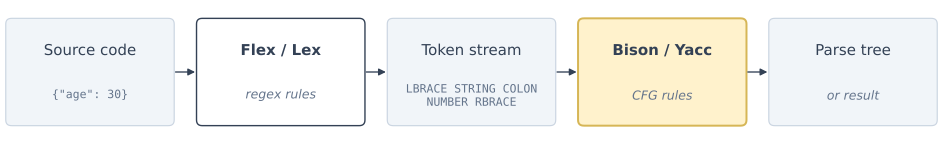
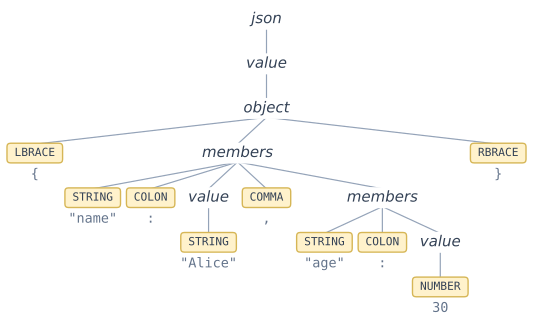
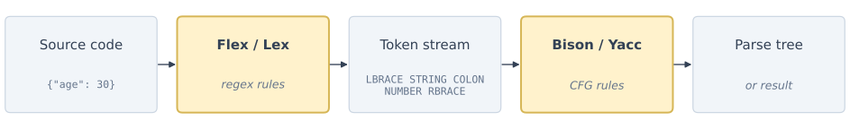
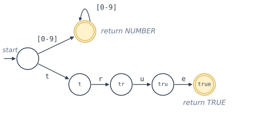
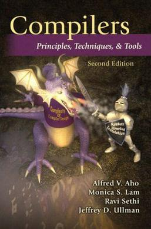
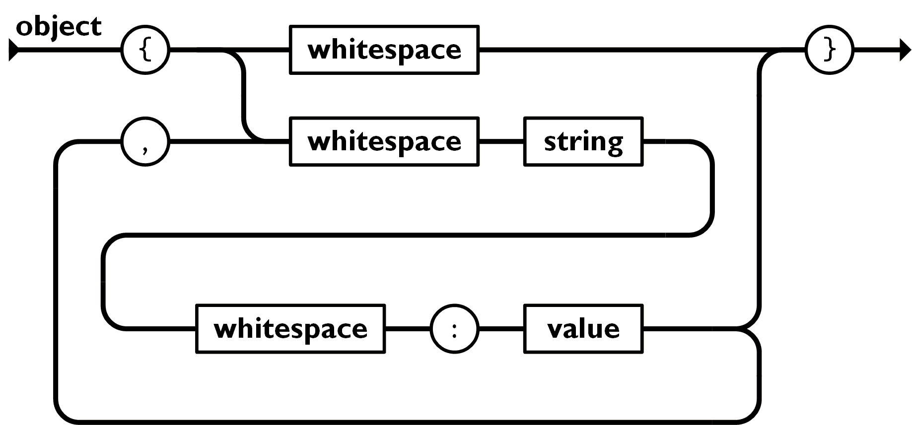
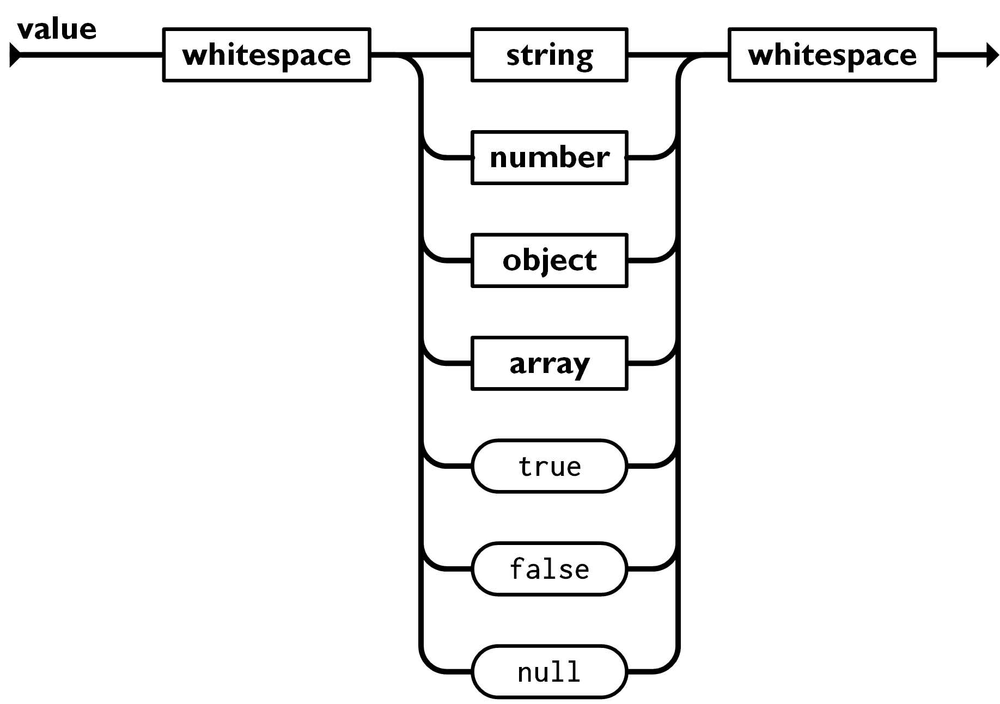
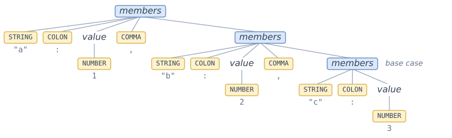
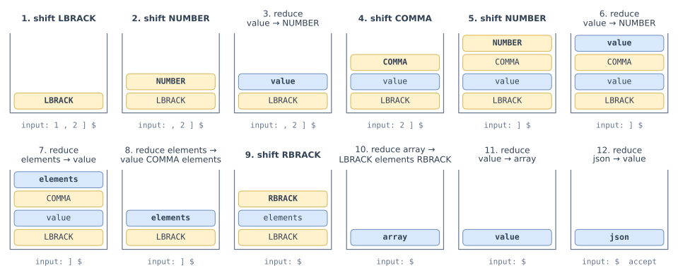

# Parser Tools and CFGs

Parsers — From context-free grammars on the page to working compilers built with Bison and Yacc.

<figure style="margin: 1.2em auto 0; width: fit-content; text-align: center;">

<figcaption style="font-size: 0.55em; color: #64748b; margin-top: 0.35em;">Donald Knuth in 1965, the year of his LR(k) paper</figcaption>
<div style="font-size: 0.45em; color: #9ca3af; line-height: 1.3;">Photo: <em>The Big T</em>, Caltech yearbook, 1965. Public domain, Wikimedia Commons</div>
</figure>

<div style="position: absolute; bottom: 20px; right: 30px; font-size: 0.55em; color: navy;">All references are to the 4th edition of <em>An Introduction to the Analysis of Algorithms</em> (World Scientific, 2025)</div>

---

# The Big Picture

<div style="color: #9ca3af; font-style: italic; font-size: 0.9em; margin-bottom: 0.8em;">

A grammar describes the language; a parser generator turns it into a working recognizer.

</div>


- **Context-Free Grammars (CFGs)** define languages
- **Parsers** recognize whether strings belong to those languages
- **Parser generators** automatically create parsers from CFG specifications




<div style="font-size: 0.6em; color: #64748b; text-align: center; margin-top: 0.4em;">The parser generator (highlighted) turns CFG rules into the parser.</div>


---

# What is a Parser?

<div style="color: #9ca3af; font-style: italic; font-size: 0.9em; margin-bottom: 0.8em;">

It reads tokens, checks them against grammar rules, and either accepts or builds a parse tree.

</div>

<div class="grid gap-6" style="grid-template-columns: 2fr 3fr;">
<div>

A parser is a program that:

1. **Reads** a sequence of tokens (from a lexer)
2. **Analyzes** them according to grammar rules
3. **Determines** if the input is valid (syntactically correct)
4. **Optionally** builds a parse tree or performs actions


**Example:** Is a JSON object like name:Alice valid?

</div>
<div style="text-align: center;">



<div style="font-size: 0.6em; color: #64748b; margin-top: 0.3em;">Parse tree for <code>{"name": "Alice", "age": 30}</code></div>

</div>
</div>


---

# CFG Review

<div style="color: #9ca3af; font-style: italic; font-size: 0.9em; margin-bottom: 0.8em;">

Terminals, non-terminals, productions, and a start symbol — the four ingredients of a grammar.

</div>

A Context-Free Grammar consists of:


- **Terminals:** Basic symbols (tokens)
- **Non-terminals:** Syntactic categories like object, array, value
- **Production rules:** How non-terminals expand
- **Start symbol:** Where parsing begins


Example productions:

- value → STRING or NUMBER or object or array
- object → empty braces or braces with members
- array → empty brackets or brackets with elements


---

# The Tool Chain

<div style="color: #9ca3af; font-style: italic; font-size: 0.9em; margin-bottom: 0.8em;">

Flex turns characters into tokens; Bison turns tokens into a parse — two tools, one pipeline.

</div>

<div class="grid grid-cols-2 gap-8 mt-4">
<div>

**Flex (Lexer Generator)**
- Input: Regular expressions
- Output: Lexical analyzer (scanner)
- Converts character stream to tokens

</div>
<div>

**Bison (Parser Generator)**
- Input: CFG rules
- Output: Parser
- Analyzes token stream

</div>
</div>



---

# Flex: The Lexer

<div style="color: #9ca3af; font-style: italic; font-size: 0.9em; margin-bottom: 0.8em;">

Each regex maps to a token — a direct application of regular languages from Section 9.3.

</div>

<div class="grid grid-cols-2 gap-6">
<div>

Flex uses **regular expressions** to define tokens:

- Match literal braces: return LBRACE, RBRACE
- Match "true": return TRUE token
- Match "false": return FALSE token
- Match quoted strings: return STRING token
- Match numbers: return NUMBER token
- Skip whitespace

</div>
<div style="text-align: center;">



<div style="font-size: 0.6em; color: #64748b; margin-top: 0.4em; text-align: left;">Flex compiles all the rules into one DFA. This one covers <code>[0-9]+</code> and <code>"true"</code>. Accepting states return a token; missing edges go to a reject state. DFAs are Section 9.3.</div>

</div>
</div>


This connects to **Regular Languages** (Section 9.3)!


---

# Bison: The Parser

<div style="color: #9ca3af; font-style: italic; font-size: 0.9em; margin-bottom: 0.8em;">

Each rule is a CFG production — a direct application of context-free grammars from Section 9.4.

</div>

Bison uses **CFG production rules**:

- value: STRING or NUMBER or TRUE or FALSE or object or array
- object: LBRACE RBRACE or LBRACE members RBRACE
- array: LBRACK RBRACK or LBRACK elements RBRACK


This connects to **Context-Free Grammars** (Section 9.4)!


---

# Lex vs Flex

<div style="color: #9ca3af; font-style: italic; font-size: 0.9em; margin-bottom: 0.8em;">

Lex is the 1975 Bell Labs original; Flex is the open-source rewrite — same `.l` syntax.

</div>

<div class="grid grid-cols-3 gap-6">
<div>

**Lex** (original, 1975)
- Created at Bell Labs
- Part of original Unix
- Proprietary versions exist

</div>
<div>

**Flex** (modern, 1987)
- "Fast Lexical Analyzer"
- Open source replacement
- Faster and more features
- What you should use today

</div>
<div>
<figure style="margin: 0.4em 0 0;">

<figcaption style="font-size: 0.55em; color: #64748b; margin-top: 0.35em;">Bell Labs, Murray Hill, New Jersey</figcaption>
<div style="font-size: 0.45em; color: #9ca3af; line-height: 1.3;">Photo: Ken Lund, CC BY-SA 2.0, Wikimedia Commons</div>
</figure>
</div>
</div>


**Both use the same .l file format!**

---

# Flex/Lex Code Example

<div style="color: #9ca3af; font-style: italic; font-size: 0.9em; margin-bottom: 0.8em;">

A real `.l` file: pattern on the left, C action on the right — that's the whole language.

</div>

**File: json_lexer.l**

```
%%
"true"          { return TRUE; }
"false"         { return FALSE; }
"null"          { return NULL_VAL; }
[0-9]+          { return NUMBER; }
[ \t\n]+        { /* skip whitespace */ }
.               { return yytext[0]; }
%%
```


**Structure:** Pattern on left, action on right

Each line: **regex** → **C code to execute**


---

# Understanding Flex Rules

<div style="color: #9ca3af; font-style: italic; font-size: 0.9em; margin-bottom: 0.8em;">

Reading the patterns row by row — and noticing they're all just regular expressions.

</div>

| Pattern | Meaning | Token Returned |
|---------|---------|----------------|
| "true" | Literal string | TRUE |
| "false" | Literal string | FALSE |
| [0-9]+ | One or more digits | NUMBER |
| [ \t\n]+ | Whitespace | (skip) |
| . | Any other character | The character itself |


**Key insight:** These are **regular expressions** - the theory from Section 9.3!


---

# Yacc vs Bison

<div style="color: #9ca3af; font-style: italic; font-size: 0.9em; margin-bottom: 0.8em;">

Yacc is the 1975 LALR(1) original; Bison is the GNU rewrite — backward compatible, more features.

</div>

<div class="grid grid-cols-2 gap-8">
<div>

**Yacc** (original, 1975)
- "Yet Another Compiler-Compiler"
- Created at Bell Labs
- LALR(1) parser generator

**Bison** (modern, 1985)
- GNU replacement for Yacc
- Backward compatible
- Additional features (GLR parsing)
- What you should use today


**Both use the same .y file format!**


</div>
<div style="text-align: center;">

<div style="display: flex; justify-content: center; align-items: flex-end; gap: 1.2em;">

<figure style="margin: 0; text-align: center;">

</figure>
</div>
<div style="font-size: 0.55em; color: #64748b; margin-top: 0.35em;">The "Dragon Book" (Aho, Lam, Sethi, Ullman, 2nd ed., 2006) covers LR parsing and Yacc.</div>
<div style="font-size: 0.45em; color: #9ca3af; line-height: 1.3;">Cover: Addison-Wesley, 2006. Low-resolution image from Wikipedia, used under fair use.</div>

<div style="font-size: 0.7em; color: #444; margin-top: 10px; text-align: left;">

**Bison: The Yacc-compatible Parser Generator** -- the official GNU manual is the definitive reference for writing grammars, building parsers, handling conflicts, and using advanced features like GLR parsing and Bison's C++ skeleton.

<div style="font-size: 0.85em; color: gray; margin-top: 6px; text-align: center;">

https://www.gnu.org/software/bison/manual/

</div>

</div>

</div>
</div>

---

# Bison/Yacc Code Example

<div style="color: #9ca3af; font-style: italic; font-size: 0.9em; margin-bottom: 0.8em;">

A real `.y` file: non-terminal on the left, alternatives separated by `|` — pure CFG productions.

</div>

**File: json_parser.y**

```
%%
json: value ;

value: STRING
     | NUMBER
     | TRUE
     | FALSE
     | object
     | array
     ;

object: LBRACE RBRACE
      | LBRACE members RBRACE
      ;
%%
```

---

# Understanding Bison Rules

<div style="color: #9ca3af; font-style: italic; font-size: 0.9em; margin-bottom: 0.8em;">

Reading each Bison rule line by line — direct translations of CFG productions into ASCII.

</div>

**Rule structure:** non-terminal: alternatives ;

| Rule | Meaning |
|------|---------|
| json: value | A JSON doc is a value |
| value: STRING or NUMBER... | Value can be several things |
| object: LBRACE RBRACE | Empty braces = empty object |
| object: LBRACE members RBRACE | Braces with members inside |


**Key insight:** These are **CFG production rules** - the theory from Section 9.4!


---

# Complete File Structure

<div style="color: #9ca3af; font-style: italic; font-size: 0.9em; margin-bottom: 0.8em;">

Both `.l` and `.y` files share the same three-section layout split by `%%`.

</div>

<div class="grid grid-cols-2 gap-4">
<div>

**Flex file (.l)**

```
%{
  /* C declarations */
  #include "parser.tab.h"
%}
%%
  /* regex rules */
%%
  /* C functions */
```

</div>
<div>

**Bison file (.y)**

```
%{
  /* C declarations */
%}
%token STRING NUMBER
%%
  /* grammar rules */
%%
  /* C functions */
```

</div>
</div>


Both have three sections separated by %%


---

# JSON Grammar in Bison

<div style="color: #9ca3af; font-style: italic; font-size: 0.9em; margin-bottom: 0.8em;">

Side-by-side: textbook CFG on the left, the same rules in Bison `.y` syntax on the right.

</div>

<div class="grid grid-cols-2 gap-4">
<div>

**CFG (Theory)**

- json → value
- value → STRING or NUMBER or TRUE or FALSE or NULL or object or array
- object → empty or with members
- members → member or member, members
- array → empty or with elements
- elements → value or value, elements

</div>
<div>

**Bison (Practice)**

- json: value;
- value: STRING or NUMBER or TRUE or FALSE or NULL_VAL or object or array;
- object: braces empty or braces with members;
- members: STRING COLON value or STRING COLON value COMMA members;

</div>
</div>

---

# JSON Grammar as Railroad Diagrams

<div style="color: #9ca3af; font-style: italic; font-size: 0.9em; margin-bottom: 0.8em;">

The JSON spec draws the same grammar as railroad diagrams. Any path from left to right is a valid string.

</div>

<div class="grid grid-cols-2 gap-6 items-start">
<div>

**object**



The loop back through "," is the recursive rule for members.

</div>
<div>

**value**



</div>
</div>

<div style="font-size: 0.55em; color: #9ca3af; margin-top: 0.6em;">Diagrams: Douglas Crockford, json.org (https://www.json.org/json-en.html)</div>

---

# Recursive Rules

<div style="color: #9ca3af; font-style: italic; font-size: 0.9em; margin-bottom: 0.8em;">

Self-referential productions are how CFGs express lists of unbounded length.

</div>

**Key insight:** Lists are naturally recursive!

<div class="grid grid-cols-2 gap-6" style="font-size: 0.9em; margin-top: -0.8em; margin-bottom: -0.6em;">
<div>

**Members** (key-value pairs in objects):
- Base case: One member
- Recursive: One member, comma, more members

</div>
<div>

**Elements** (values in arrays):
- Base case: One element
- Recursive: One value, comma, more values

</div>
</div>



<div style="font-size: 0.6em; color: #64748b; text-align: center;"><code>members</code> for <code>"a": 1, "b": 2, "c": 3</code>. Each level peels off one pair.</div>

This is exactly how CFGs handle **unbounded repetition**!


---

# Building a JSON Parser

<div style="color: #9ca3af; font-style: italic; font-size: 0.9em; margin-bottom: 0.8em;">

Five-step recipe: write rules, generate code, compile, run — that's a working parser.

</div>


1. **Write lexer rules** (json_lexer.l) - uses regular expressions
2. **Write grammar rules** (json_parser.y) - uses CFG
3. **Generate code:** flex and bison commands
4. **Compile:** gcc to create executable
5. **Run:** pipe JSON input to parser


---

# Theory Meets Practice

<div style="color: #9ca3af; font-style: italic; font-size: 0.9em; margin-bottom: 0.8em;">

Every concept in Chapter 9 has a direct counterpart in real lexer and parser tools.

</div>

| Theory (Chapter 9) | Practice (Parser Tools) |
|-------------------|------------------------|
| Regular Expressions | Flex/Lex patterns |
| Finite Automata | Lexer state machine |
| Context-Free Grammar | Bison/Yacc rules |
| Pushdown Automata | Parser stack |
| Derivations | Parse tree construction |


**The tools automate what we learn in theory!**


---

# The Parser Stack: Parsing [1, 2]

<div style="color: #9ca3af; font-style: italic; font-size: 0.9em; margin-bottom: 0.8em;">

Bison runs a pushdown automaton: shift tokens, reduce when a rule's right side is on top.

</div>



<div style="font-size: 0.6em; color: #64748b; text-align: center; margin-top: 0.3em;">Rules used: json → value, value → NUMBER | array, array → LBRACK elements RBRACK, elements → value | value COMMA elements. $ marks the end of input.</div>

---

# Why This Matters

<div style="color: #9ca3af; font-style: italic; font-size: 0.9em; margin-bottom: 0.8em;">

Compilers, data formats, config files, protocols — parsers are quietly running everywhere.

</div>


- **Compilers:** Parse programming languages (C, Java, Python)
- **Data formats:** Parse JSON, XML, YAML, HTML
- **Configuration files:** Parse nginx.conf, .gitignore
- **Domain-specific languages:** SQL, regular expressions, math notation
- **Protocol parsing:** HTTP headers, email formats


Every time you use a programming language, a parser (built from CFG theory) is at work!

<div style="display: flex; justify-content: center; align-items: flex-end; gap: 3em; margin-top: 0.6em;">
<figure style="margin: 0; text-align: center;"><figcaption style="font-size: 0.55em; color: #64748b;">JSON</figcaption></figure>
<figure style="margin: 0; text-align: center;"><figcaption style="font-size: 0.55em; color: #64748b;">Python</figcaption></figure>
<figure style="margin: 0; text-align: center;"><figcaption style="font-size: 0.55em; color: #64748b;">SQL</figcaption></figure>
<figure style="margin: 0; text-align: center;"><figcaption style="font-size: 0.55em; color: #64748b;">nginx.conf</figcaption></figure>
</div>

<div style="font-size: 0.45em; color: #9ca3af; text-align: center; margin-top: 0.5em;">Wikimedia Commons: JSON logo, Douglas Crockford, public domain. Python logo, python.org, public domain. Database icon, Zahra Ibrahem, CC BY-SA 4.0. nginx logo, Igor Sysoev, public domain.</div>

---

# Resources

<div style="color: #9ca3af; font-style: italic; font-size: 0.9em; margin-bottom: 0.8em;">

Where to read the specs and find the manuals — and the JSON-parser assignment.

</div>


- **JSON specification:** https://www.json.org/json-en.html
- **Bison manual:** https://www.gnu.org/software/bison/manual/
- **Flex manual:** https://github.com/westes/flex
- **Classic reference:** http://dinosaur.compilertools.net


**Assignment:** Complete the JSON parser in Classroom 50
