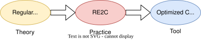
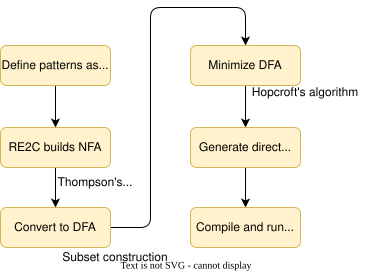

# RE2C and Regular Languages

re2c — A lexer generator that compiles regex straight to fast `goto`-driven C code.

<div style="position: absolute; bottom: 20px; right: 30px; font-size: 0.55em; color: navy;">All references are to the 4th edition of <em>An Introduction to the Analysis of Algorithms</em> (World Scientific, 2025)</div>

---

# Regex Tools

<div style="color: #9ca3af; font-style: italic; font-size: 0.85em; margin-bottom: 0.45em;">

You already match text with regular expressions. RE2C compiles those same patterns into a C lexer.

</div>

<div class="re2c-tools">

| Tool | Example | Meaning | Service |
|------|---------|---------|---------|
| **grep** | <code>grep error log.txt</code> | Print every line that mentions "error." | <em class="re-svc">used to hunt crash lines in Netflix's overnight logs</em> |
| **egrep** | <code>egrep 'cat&#124;dog' pets.txt</code> | Print lines that mention cat or dog. | <em class="re-svc">used to find "late&#124;cold" on DoorDash support tickets</em> |
| **sed** | <code>sed 's/colour/color/g' essay.txt</code> | Rewrite every "colour" as "color." | <em class="re-svc">used to rewrite API hosts in Stripe's deploy scripts</em> |
| **awk** | <code>awk '/TODO/ {print $2}' notes.txt</code> | On lines that contain TODO, print the second word. | <em class="re-svc">used to pull the fare column off Uber's trip dumps</em> |
| **vim** | <code>:g/TODO/d</code> | Delete every line that mentions TODO. | <em class="re-svc">used to patch Kubernetes YAML at Cloudflare</em> |
| **emacs** | <code>C-M-s [0-9]+</code> | Search forward for the next run of digits. | <em class="re-svc">used to edit trading code at Jane Street</em> |
| **perl** | <code>perl -pe 's/\d+/N/g' data.txt</code> | Turn every run of digits into N. | <em class="re-svc">used to parse taxes at File Your Taxes in Oxnard</em> |
| **python** | <code>re.search(r'\d{3}-\d{4}', line)</code> | Ask whether the line holds a 3-then-4 digit chunk. | <em class="re-svc">used to run Instagram, and Netflix's recommendation jobs</em> |

</div>

<div style="color: #0f172a; font-size: 0.78em; margin-top: 0.35em; text-align: left; width: 96%; margin-left: auto; margin-right: auto;">

<strong>Advantage of RE2C.</strong> These eight tools interpret a pattern as they run, which is right for a one-off search. RE2C compiles the pattern once into a <code>goto</code>-driven DFA in C, so a lexer that runs on every PHP request or Ninja build pays only the cost of those jumps.

</div>

<style>
.re2c-tools {
  font-size: 0.78em;
  text-align: left;
  width: 96%;
  margin: 0 auto;
  line-height: 1.2;
}
.re2c-tools table :is(th, td) {
  padding-top: 0.16em !important;
  padding-bottom: 0.16em !important;
  line-height: 1.2 !important;
  text-align: left;
  vertical-align: top;
}
.re2c-tools .re-svc {
  font-style: italic;
  color: #4B0082;
}
.re2c-tools code {
  font-size: 0.86em;
  background: #f3f4f6;
  padding: 0.05em 0.3em;
  border-radius: 3px;
}
</style>

---

# The Big Picture

<div style="color: #9ca3af; font-style: italic; font-size: 0.9em; margin-bottom: 0.8em;">

Regex describes a pattern; a finite automaton recognizes it; a lexer generator builds the code.

</div>

- **Regular expressions** define patterns
- **Finite automata** recognize those patterns
- **Lexer generators** compile regex to code that scans input



Today: how the theory from Chapter 9.3 powers a real tool used in production systems

---

# Regular Language Review

<div style="color: #9ca3af; font-style: italic; font-size: 0.9em; margin-bottom: 0.8em;">

Regex, DFAs, and NFAs all describe the same class — that equivalence is what makes lexer generators work.

</div>

A language is **regular** if it can be described by:

- **Regular expression**
- **DFA** (Deterministic Finite Automaton)
- **NFA** (Nondeterministic Finite Automaton)

**Theorem:** These three are equivalent!

This equivalence is the foundation for all lexer generators: you write patterns (regex), the tool builds the recognizer (DFA).

---

# Practical vs Formal RE Syntax

<div style="color: #9ca3af; font-style: italic; font-size: 0.9em; margin-bottom: 0.8em;">

POSIX and PCRE add convenient shortcuts, but everything reduces to $+$, $\cdot$, and ${}^*$.

</div>

Tools like RE2C use **practical syntax** (POSIX/PCRE) — but it's all **syntactic sugar** over the three operations from Section 9.3.3

<div class="grid grid-cols-2 gap-8">
<div>

**Practical (POSIX/PCRE)**

- `R?` — zero or one
- `R+` — one or more
- `[0-9]` — character class
- `[a-z]` — character range
- `R|S` — alternation

</div>
<div>

**Formal RE (Section 9.3.3)**

- $(R + \varepsilon)$
- $R \cdot R^*$
- $(0 + 1 + 2 + \cdots + 9)$
- $(a + b + \cdots + z)$
- $R + S$

</div>
</div>

**Key point:** No new expressive power! Every practical regex can be rewritten using only $+$, $\cdot$ , and $*$

```
Practical:  -?(0|[1-9][0-9]*)
Formal:     (- + ε)(0 + (1+2+...+9)(0+1+...+9)*)
```

---

# What is RE2C?

<div style="color: #9ca3af; font-style: italic; font-size: 0.9em; margin-bottom: 0.8em;">

A 1993 lexer generator from Waterloo — emits direct-coded DFAs, used by PHP and Ninja.

</div>

**RE2C** = "Regular Expressions to C"

- Created by Peter Bumbulis at U. of Waterloo (1993)
- A lexer generator: converts regular expressions directly to C code
- Generates **direct-coded DFAs** — `goto` statements, no tables!
- Produces extremely fast scanners

**Used in:** PHP (official lexer), Ninja build system, and many performance-critical applications

---

# RE2C Syntax

<div style="color: #9ca3af; font-style: italic; font-size: 0.9em; margin-bottom: 0.8em;">

Regex on the left, action on the right — embedded inside what looks like a C comment.

</div>

```c
/*!re2c
    re2c:define:YYCTYPE = char;
    re2c:yyfill:enable = 0;

    digit = [0-9];
    letter = [a-zA-Z];

    digit+          { return NUMBER; }
    letter+         { return IDENTIFIER; }
    [ \t\n]+        { goto loop; }  // skip whitespace
    *               { return ERROR; }
*/
```

Regular expression patterns on the left, actions on the right — just like the formal definition of a scanner!

---

# How RE2C Works

<div style="color: #9ca3af; font-style: italic; font-size: 0.9em; margin-bottom: 0.8em;">

Regex → Thompson NFA → subset construction DFA → C code with labels and gotos.

</div>

RE2C follows exactly the pipeline from Section 9.3:

1. **Parse** regular expressions from the `/*!re2c` block
2. **Build** NFA using Thompson's construction
3. **Convert** NFA to DFA (subset construction)
4. **Minimize** DFA (optional)
5. **Generate** C code with `goto` statements

| Theory (Chapter 9) | RE2C Implementation |
|-------------------|---------------------|
| Regular Expression | Input specification |
| Thompson's Construction | NFA building |
| Subset Construction | NFA → DFA conversion |
| DFA States | Code labels (`yy1:`, `yy2:`, ...) |
| DFA Transitions | `goto` statements |

---

# Generated Code Example

<div style="color: #9ca3af; font-style: italic; font-size: 0.9em; margin-bottom: 0.8em;">

The output really is just the DFA — labels are states, `goto`s are transitions.

</div>

**Input regex:** `[0-9]+`

**Generated C code:**
```c
yy1:
    yych = *YYCURSOR++;
    if (yych <= '/') goto yy3;
    if (yych <= '9') goto yy4;
yy3:
    { return ERROR; }
yy4:
    yych = *YYCURSOR++;
    if (yych <= '/') goto yy5;
    if (yych <= '9') goto yy4;
yy5:
    { return NUMBER; }
```

This IS the DFA, encoded as control flow! Each label is a state, each `goto` is a transition.

---

# Performance: Direct-Coded vs Table-Driven

<div style="color: #9ca3af; font-style: italic; font-size: 0.9em; margin-bottom: 0.8em;">

No table lookups, better branch prediction, smaller code — that's where the 2–3× speedup comes from.

</div>

**Why is direct-coded DFA faster?**

1. **No table lookups** — transitions are direct jumps
2. **Better branch prediction** — CPU can predict `goto` patterns
3. **Smaller code size** — no transition tables in memory
4. **Cache-friendly** — code locality is better

**Benchmarks:** RE2C-generated lexers can be 2-3x faster than table-driven ones

---

# RE2C vs Other Lexer Tools

<div style="color: #9ca3af; font-style: italic; font-size: 0.85em; margin-bottom: 0.45em;">

Flex, RE2C, Ragel, hand-written — all the same theory, only the code-generation step differs.

</div>

<div class="re2c-cmp" style="font-size: 0.88em; text-align: left; line-height: 1.25;">

**Flex** = "Fast Lexical Analyzer Generator." Written by Vern Paxson (~1987) at Lawrence Berkeley Lab as a free replacement for AT&T's proprietary **Lex** (1975, Bell Labs). The classic Unix lexer tool, typically paired with Bison/Yacc for parsing.

<div style="font-size: 0.9em;">

| Tool | Approach | Speed | Portability |
|------|----------|-------|-------------|
| **Flex** | Table-driven DFA | Good | Excellent |
| **RE2C** | Direct-coded DFA | Excellent | Good |
| **Ragel** | Multiple backends | Excellent | Good |
| **Hand-written** | Manual | Varies | Excellent |

</div>

All implement the same theory: **Regular Expression → NFA → DFA → Code**

The difference is only in the final step — how the DFA is represented in code.

</div>

<style>
.re2c-cmp table :is(th, td) {
  padding-top: 0.18em !important;
  padding-bottom: 0.18em !important;
  line-height: 1.2 !important;
}
</style>

---

# Practical Example: Simple Lexer

<div style="color: #9ca3af; font-style: italic; font-size: 0.9em; margin-bottom: 0.8em;">

A complete `.re` file you could compile right now — numbers, words, whitespace, errors.

</div>

```c
#include <stdio.h>

int lex(const char *YYCURSOR) {
    const char *YYMARKER;
    /*!re2c
        re2c:define:YYCTYPE = char;
        re2c:yyfill:enable = 0;

        [0-9]+      { return 1; }  // NUMBER
        [a-z]+      { return 2; }  // WORD
        [ \t\n]+    { return 0; }  // WHITESPACE
        *           { return -1; } // ERROR
    */
}
```

Run `re2c lexer.re -o lexer.c` to generate C code!

---

# Example: Tokenizing JSON Numbers

<div style="color: #9ca3af; font-style: italic; font-size: 0.9em; margin-bottom: 0.8em;">

One line of regex compiles to a 15–20-state DFA — that's the leverage of automation.

</div>

A more complex example — the **regular expression for JSON numbers:**

```
-?(0|[1-9][0-9]*)(\.[0-9]+)?([eE][+-]?[0-9]+)?
```

Breaking it down:
- `-?` — optional minus sign
- `(0|[1-9][0-9]*)` — integer part (no leading zeros except for 0)
- `(\.[0-9]+)?` — optional decimal part
- `([eE][+-]?[0-9]+)?` — optional exponent

RE2C compiles this to a DFA with ~15-20 states — all generated automatically from one line of regex!

---

# RE2C in the Real World

<div style="color: #9ca3af; font-style: italic; font-size: 0.9em; margin-bottom: 0.8em;">

PHP, Ninja, YASM, BRL-CAD — places where every microsecond of lexing actually matters.

</div>

<div class="grid grid-cols-2 gap-8">
<div>

**PHP Language**
- The official PHP lexer is built with RE2C
- Handles PHP's complex syntax efficiently
- Millions of requests rely on this daily

**Ninja Build System**
- Fast build tool (used by Chrome, LLVM)
- RE2C parses build files quickly

**Other uses:**
- SpamAssassin, YASM assembler, BRL-CAD

</div>
<div>

**Why PHP chose RE2C over Flex**
- The generated lexer was 2-3x faster
- At web scale, that matters

**Under the hood**
- Uses *lookahead TDFA* for submatch extraction
- Builds *tunnel automata* to shrink output

**Installation:**
```bash
# Ubuntu/Debian
sudo apt-get install re2c

# macOS
brew install re2c
```

</div>
</div>

---

# Limitations

<div style="color: #9ca3af; font-style: italic; font-size: 0.9em; margin-bottom: 0.8em;">

Balanced parens, equal counts, nested structure — these need a CFG, not a finite automaton.

</div>

**What RE2C (and regex) CANNOT do:**

- Match balanced parentheses: `(()())` — not regular!
- Count occurrences: "same number of a's and b's"
- Parse nested structures (need CFG for that)

**Pumping Lemma** tells us these are impossible with finite automata.

That's why we need **parsers** (CFGs) for programming languages — the lexer handles tokens, the parser handles structure!

---

# Theory to Practice Pipeline

<div style="color: #9ca3af; font-style: italic; font-size: 0.9em; margin-bottom: 0.8em;">

The full path from Section 9.3 to a production scanner, in one diagram.

</div>



**Everything you learn in Chapter 9.3 powers this!**

---

# RE2C Resources

<div style="color: #9ca3af; font-style: italic; font-size: 0.9em; margin-bottom: 0.8em;">

Where to read the docs, browse the source, and try RE2C in your browser.

</div>

- **Official site:** https://re2c.org/
- **Documentation:** https://re2c.org/manual/manual.html
- **GitHub:** https://github.com/skvadrik/re2c
- **Try online:** https://re2c.org/manual/manual_c.html (examples)
